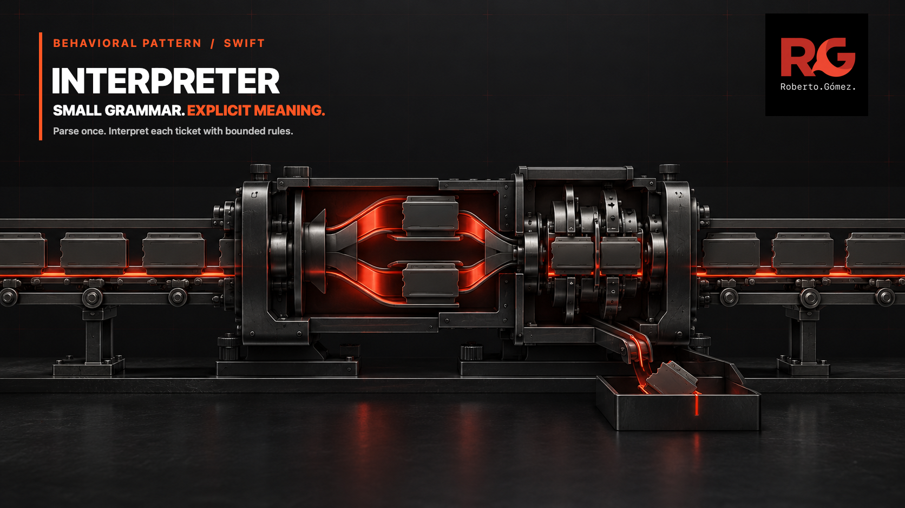
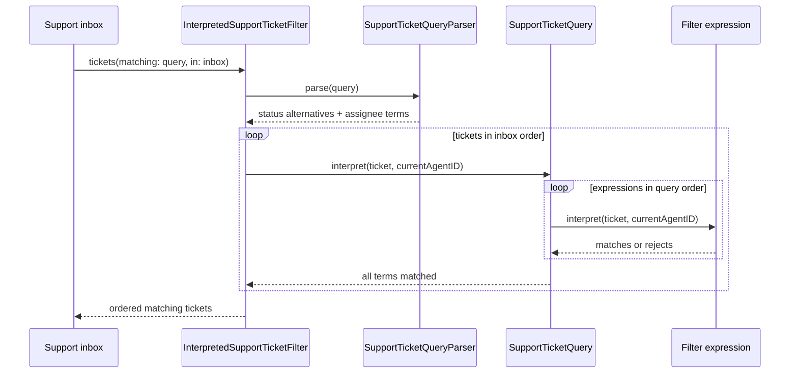

# 🧩 Interpreter



> **Caption:** A bounded support language separates parsing from interpretation:
> local status alternatives recombine before outer terms narrow the ordered inbox.

**Category:** Behavioral

## 🎯 The app problem

A customer-support inbox accepts compact saved filters such as
`status:(open|waiting) assignee:me`. Agents need a view that includes more than
one active lifecycle state, still restricts results to their own queue, and
points an inline editor at the exact character when the query is invalid.

The language is intentionally small:

```text
query          = term *(whitespace term)
term           = status-term / assignee-term
status-term    = "status:" status-value
status-value   = status / "(" status *("|" status) ")"
status         = "open" / "waiting" / "closed"
assignee-term  = "assignee:" ("me" / "unassigned")
```

Terms use AND. Alternatives inside one status group use OR. Repeated fields
remain legal and conjunctive, matching tickets preserve the inbox service's
order, and a blank query returns the original collection. Grouped assignees,
nesting, global OR, NOT, precedence, escaping, quoted values, ranges, free text,
and arbitrary agent identifiers are not part of the product requirement.

### Requirements

- Parse the query once before evaluating tickets.
- Keep syntax failures separate from unsupported domain vocabulary.
- Report zero-based character positions for every rejected term or value.
- Resolve `assignee:me` from an injected agent identifier, never global state.
- Preserve local OR, query-wide AND, repeated-field behavior, and input order.
- Keep the grammar visible without building a general parser framework.

## 🪶 Start with direct Swift

[`SupportTicketFilterDirect.swift`](../../Sources/DesignPatterns/Interpreter/SupportTicketFilterDirect.swift)
starts with two atomic fields in one loop. It splits whitespace-delimited
`field:value` terms, validates a small vocabulary, and filters the working
ticket array after every term. That is the clearest solution for
`status:open assignee:me`: no expression types, lexer, AST, registry, or parser
dependency improve two independent branches.

The [problem definition](../../Documentation/interpreter-problem.md) fixes the
domain invariants and acceptance tests before considering the pattern.

## ⚡ The turning point

[`SupportTicketFilterPressure.swift`](../../Sources/DesignPatterns/Interpreter/SupportTicketFilterPressure.swift)
adds `status:(open|waiting)` and exact diagnostic positions while deliberately
remaining direct. One grouped value introduces:

| Pressure signal | Atomic language | Grouped language |
| --- | ---: | ---: |
| Value shapes | 1 | 2 |
| Structural delimiters | 1 | 4 |
| Composition scopes | 1 | 2 |
| Positioned syntax failure families | 0 | 5 |

Parsing shape, source-position bookkeeping, domain validation, and immediate
filtering now share the same scanner. The code still works, but a new diagnostic
or evaluator would need to understand that entire control flow. This is the
specific pressure that earns a small language representation—not the mere
presence of strings and colons.

The [pressure review](../../Documentation/interpreter-pressure.md) records the
grammar boundary and the point at which a maintained parser library should
replace hand-written parsing.

## 🧭 Pattern intent

Interpreter represents the bounded query as domain expressions and gives each
expression one way to evaluate a ticket. `SupportTicketQueryParser` owns syntax
and positions. `SupportTicketQuery` interprets its terms as one conjunction.
`SupportTicketFilterExpression` interprets either a set of accepted statuses or
one assignee alias.

The representation follows the grammar without mirroring every token. A colon,
parenthesis, and pipe remain parser details. There is no class per terminal,
recursive expression tree, generic context dictionary, visitor, runtime rule
registration, or protocol with one implementation.

## 🧩 Participants and responsibilities

| App role | Swift type | Responsibility |
| --- | --- | --- |
| Client boundary | [`InterpretedSupportTicketFilter`](../../Sources/DesignPatterns/Interpreter/SupportTicketInterpreter.swift) | Parses one query, evaluates it against tickets, and preserves input order. |
| Parser | [`SupportTicketQueryParser`](../../Sources/DesignPatterns/Interpreter/SupportTicketInterpreter.swift) | Scans bounded terms, validates delimiters and vocabulary, and retains source positions in errors. |
| Nonterminal expression | [`SupportTicketQuery`](../../Sources/DesignPatterns/Interpreter/SupportTicketInterpreter.swift) | Interprets query-wide AND with `allSatisfy`. |
| Terminal expressions | [`SupportTicketFilterExpression`](../../Sources/DesignPatterns/Interpreter/SupportTicketInterpreter.swift) | Interprets status membership or an assignee alias for one ticket. |
| Assignee vocabulary | [`SupportTicketAssigneeExpression`](../../Sources/DesignPatterns/Interpreter/SupportTicketInterpreter.swift) | Distinguishes the current agent from an unassigned ticket without magic stored identifiers. |
| Diagnostic vocabulary | [`SupportTicketQueryError`](../../Sources/DesignPatterns/Interpreter/SupportTicketInterpreter.swift) | Separates grammar failures from unsupported fields and values at exact character offsets. |

The existing `SupportTicket` and `SupportTicketStatus` domain values remain the
evaluation input. The current-agent identifier is supplied to the filter and
passed explicitly during interpretation, so expressions stay deterministic and
`Sendable` without a shared session service.

## ⚙️ How the Swift implementation works

1. `InterpretedSupportTicketFilter` asks the parser to read the complete query.
2. The parser scans non-whitespace terms and records each term's starting
   character offset.
3. A status atom becomes `.status([status])`; a group becomes one `.status`
   expression containing a `Set` of alternatives.
4. An assignee alias becomes `.assignee(.currentAgent)` or
   `.assignee(.unassigned)`.
5. `SupportTicketQuery` stores expressions in source order and interprets them
   with `allSatisfy`, making outer AND explicit.
6. The filter walks the original ticket array once. Swift's `filter` preserves
   order while each ticket is accepted only when every expression matches.

The core evaluation boundary is deliberately compact:

```swift
public func interpret(
    _ ticket: SupportTicket,
    currentAgentID: String
) -> Bool {
    expressions.allSatisfy {
        $0.interpret(ticket, currentAgentID: currentAgentID)
    }
}
```

Status OR is data inside one terminal expression, not a second recursive
operator. That choice matches today's grammar and prevents a speculative tree
whose only possible nesting would be immediately rejected.

## 🗺️ Diagram



Observe the separation between reading the language and applying its meaning:
the parser produces expressions once, then the same query interprets every
ticket. The status expression owns its local alternatives; the query owns only
the conjunction between terms.

**Accessible description:** The support inbox sends a query and ordered ticket
list to the filter. The parser converts the query into status and assignee
expressions once. For each ticket in original order, the query asks every term
expression whether it matches. Only tickets accepted by all terms return to the
inbox, still in their source order.

## ▶️ Run the example

From the repository root, using Swift 6 on macOS 14 or later:

```sh
swift build -Xswiftc -warnings-as-errors
swift test -Xswiftc -warnings-as-errors --filter Interpreter
```

The package is a library. Tests parse saved-view strings and inspect expression
values, matching tickets, stable ordering, and typed diagnostic positions; no
executable app or console output is required.

## 🧪 Tests

[`InterpreterTests.swift`](../../Tests/DesignPatternsTests/InterpreterTests.swift)
verifies:

- parsing produces explicit expressions for local OR and outer AND;
- a blank query is a valid empty conjunction;
- grouped statuses compose with current-agent and unassigned aliases;
- alternative order never changes inbox order;
- repeated fields remain conjunctive; and
- malformed syntax and unsupported vocabulary report exact positions through a
  parameterized diagnostic table.

The same test filter also runs
[`InterpreterProblemTests.swift`](../../Tests/DesignPatternsTests/InterpreterProblemTests.swift)
and
[`InterpreterPressureTests.swift`](../../Tests/DesignPatternsTests/InterpreterPressureTests.swift),
keeping the direct baseline and the measured pressure executable.

## ⚖️ Trade-offs

### What improves

- Parsing and evaluation can change independently inside the fixed grammar.
- Diagnostics retain source structure instead of disappearing inside predicate
  closures.
- Query semantics are inspectable values that tests can compare directly.
- Each query is parsed once and each ticket keeps one stable-order evaluation
  pass.
- One enum covers the two expression families without terminal subclasses or a
  protocol hierarchy.

### What it costs

- The query now has a second representation after its source string.
- The parser and expression vocabulary must evolve together when grammar
  changes.
- A public expression array exposes the deliberately bounded language shape.
- `Set` makes alternative order irrelevant, which is correct for matching but
  would not preserve authoring order for a query formatter.
- Hand-written character scanning remains responsible for one-error-at-a-time
  diagnostics.

## 🔀 Alternatives considered

| Alternative | Prefer it when | Why Interpreter wins here |
| --- | --- | --- |
| Direct field switch | Terms remain independent atoms and errors do not need structural positions. | A grouped status now has its own composition scope and syntax failures. |
| Dictionary of predicate closures | New atomic fields are the only extension and expressions need no inspection. | Closures lose source structure needed for diagnostics and saved-query tooling. |
| `NSPredicate` | An Objective-C model or platform query consumer already requires its semantics. | String key paths and platform coercions weaken this small value-semantic vocabulary. |
| Typed server parameters | The backend owns filtering and the app never evaluates saved views locally. | This inbox must filter an already loaded ordered collection offline. |
| Maintained parser library | Nesting, precedence, escaping, recovery, or a shared grammar becomes real. | One non-nested status group does not justify a dependency or generic parser layer. |

### Interpreter versus nearby patterns

- **Strategy** selects one interchangeable algorithm behind a stable input and
  output contract. This example evaluates a composed language whose terms all
  participate in one query.
- **Composite** models uniform part-whole structures. This grammar deliberately
  rejects nesting; the query's expression list is not a general object tree.
- **Chain of Responsibility** gives successive handlers a chance to own a
  request. Every query term must evaluate, so no handler claims or forwards the
  ticket.
- **Specification** often combines reusable business predicates directly in
  code. Interpreter is justified here because users author a textual language
  that must be parsed and diagnosed.

## 🚫 When not to use it

- Keep a switch or dictionary when filters are independent field-value atoms.
- Do not create expression types merely because an API accepts a string.
- Prefer native Swift enums, functions, and `Set` membership when no language
  composition or source diagnostics exist.
- Send typed parameters when only a server consumes the query.
- Do not extend this parser with recursive groups, precedence, quoting,
  escaping, or multi-error recovery. Adopt maintained parsing infrastructure at
  that boundary.
- Do not introduce one class per keyword, delimiter, or status value.
- Do not add a visitor, generic AST, registry, repository, async pipeline, or
  dependency container to this two-field in-memory example.

## 🗂️ Source map

- [`SupportTicketInterpreter.swift`](../../Sources/DesignPatterns/Interpreter/SupportTicketInterpreter.swift) — final expressions, parser, diagnostics, and client filter.
- [`SupportTicketFilterDirect.swift`](../../Sources/DesignPatterns/Interpreter/SupportTicketFilterDirect.swift) — atomic direct baseline and shared ticket values.
- [`SupportTicketFilterPressure.swift`](../../Sources/DesignPatterns/Interpreter/SupportTicketFilterPressure.swift) — direct positioned scanner used to measure grammar pressure.
- [`InterpreterTests.swift`](../../Tests/DesignPatternsTests/InterpreterTests.swift) — final parsing, interpretation, ordering, and diagnostic evidence.
- [`interpreter-problem.md`](../../Documentation/interpreter-problem.md) and [`interpreter-pressure.md`](../../Documentation/interpreter-pressure.md) — evidence that earned the pattern.
- [`interpreter-header.png`](../../Documentation/Assets/Patterns/behavioral/interpreter-header.png) — editorial header.
