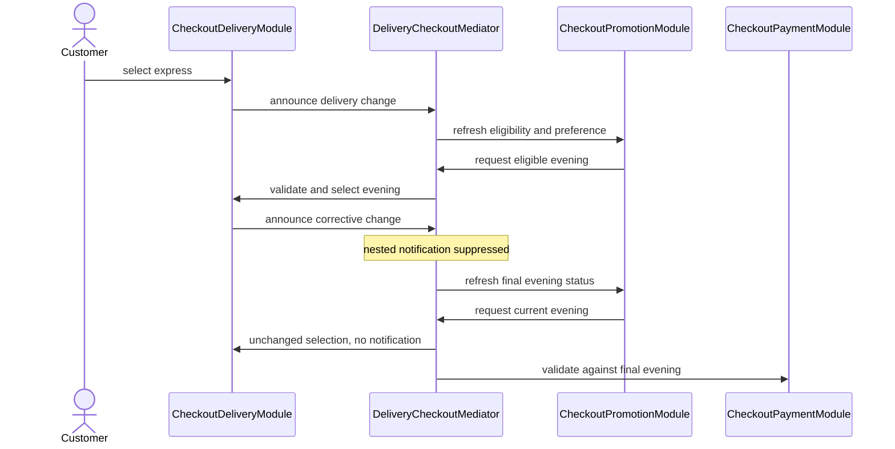

# 🔀 Mediator


> **Caption:** One routing plate resolves the delivery choice before sending
> the final state to payment, while each module retains its own validation.

**Category:** Behavioral

## 🎯 The app problem

A delivery checkout has independently maintained address, delivery-window,
promotion, and payment sections. An address determines available windows. A
window determines payment options and promotion eligibility. The promotion
section also lets a customer opt into keeping a compatible window selected.

That last action makes interaction bidirectional: delivery refreshes promotion,
and promotion can request a different delivery window. The checkout must finish
each synchronous customer action with one coherent selection.

### Requirements

- Filter windows by delivery zone and reject unavailable choices.
- Reevaluate promotion eligibility when the selected window changes.
- Enter a promotion without automatically changing the delivery choice.
- Honor an explicit preference for an eligible window until its code is cleared
  or replaced; keep a compatible current window before choosing another.
- Resolve the final delivery window before invalidating payment.
- Preserve a payment accepted by that final window; clear incompatible payments.
- Keep participant validation local and release the checkout without retain cycles.

## 🪶 Start with direct Swift

[`DeliveryCheckoutDirect.swift`](../../Sources/DesignPatterns/Mediator/DeliveryCheckoutDirect.swift)
models four fixed section values in one `DirectDeliveryCheckoutForm`. Explicit
mutation methods coordinate address, window, and payment. Promotion status is
derived when reading the snapshot. No module callbacks or separate mediator are
needed while one form owns the whole interaction.

This remains the preferred solution for that simpler ownership boundary. Four
fields in a screen are not sufficient reason to introduce Mediator.

## ⚡ The turning point

[`DeliveryCheckoutPressure.swift`](../../Sources/DesignPatterns/Mediator/DeliveryCheckoutPressure.swift)
adds independent stateful modules and the promotion's delivery preference. The
direct graph has three callback assignments, four directed participant
dependencies, and one bidirectional pair: delivery ↔ promotion.

The direct implementation requires two coordination precautions: selecting an
unchanged window must not announce another change, and payment must update
before promotion can reenter delivery. That keeps the graph coherent, but cash
can be discarded by an intermediate express choice even when promotion
immediately restores a cash-compatible evening window.

A local ordering fix preserves coherence; it does not express the stronger
product requirement to validate payment only against the final window. The
[pressure review](../../Documentation/mediator-pressure.md) records the graph
and the tests that demonstrate these interactions.

## 🧭 Pattern intent

`DeliveryCheckoutMediator` owns the interaction sequence between these modules.
Participants announce a change or request a choice through callbacks bound to
the mediator, instead of calling another participant directly.

The mediator lets promotion resolve the final window, refreshes its status if
that correction changed delivery, and only then tells payment which options
apply. It does not choose eligible windows or validate payment methods itself.

## 🧩 Participants and responsibilities

| App role | Swift type | Responsibility |
| --- | --- | --- |
| Interaction owner | [`DeliveryCheckoutMediator`](../../Sources/DesignPatterns/Mediator/DeliveryCheckoutMediator.swift) | Routes participant events and orders promotion reconciliation before payment validation. |
| Address section | [`CheckoutAddressModule`](../../Sources/DesignPatterns/Mediator/DeliveryCheckoutPressure.swift) | Owns the address and announces changes. |
| Delivery section | [`CheckoutDeliveryModule`](../../Sources/DesignPatterns/Mediator/DeliveryCheckoutPressure.swift) | Filters by zone, rejects unavailable windows, and suppresses unchanged selections. |
| Promotion section | [`CheckoutPromotionModule`](../../Sources/DesignPatterns/Mediator/DeliveryCheckoutPressure.swift) | Evaluates codes and requests an available eligible window when the customer preference is active. |
| Payment section | [`CheckoutPaymentModule`](../../Sources/DesignPatterns/Mediator/DeliveryCheckoutPressure.swift) | Rejects unavailable methods and clears selections incompatible with the supplied final window. |
| Read-only result | [`DeliveryCheckoutFormSnapshot`](../../Sources/DesignPatterns/Mediator/DeliveryCheckoutDirect.swift) | Exposes the coherent selection and order readiness after an action returns. |

The final implementation reuses the pressure-stage participants unchanged.
There is one concrete mediator, no colleague protocol, no universal event type,
and no new abstraction around domain validation. The retained pressure file
allows the same participant behavior to be compared under both interaction
policies.

## ⚙️ How the Swift implementation works

1. An address change enters the mediator's callback and updates delivery's
   available windows. A delivery selection also announces its change there.
2. `coordinateDeliveryChange()` starts one synchronous coordination operation.
3. Promotion receives the initial selection and available windows. Its active
   preference may request an eligible window through the mediator.
4. Delivery validates that request. Nested delivery notifications do not begin
   another coordination operation while the current one is resolving selection.
5. If delivery changed, the mediator refreshes promotion with the corrected
   window. The promotion preserves an eligible current window, so one corrective
   refresh suffices; there is no unbounded retry loop.
6. Payment receives the final window once. A previously selected cash method
   survives when evening remains the final choice. It is cleared when a new
   address ends at a card-only window.

These are the final payment update and the correction block from verified source:

```swift
if delivery.selectedSlot != initialSlot {
    // One correction is sufficient: promotion requests an available,
    // eligible slot and preserves it on refresh. No generic retry loop.
    promotion.updateSlot(
        delivery.selectedSlot,
        availableSlots: delivery.availableSlots
    )
}
payment.updateSlot(delivery.selectedSlot)
```

The mediator strongly owns its four modules; their installed closures capture
it weakly. No participant directly retains another participant. The mediator
must remain alive while its modules are used, and its installed callbacks must
not be replaced by callers. The example is synchronous and confined to one
checkout: these mutable reference types are not `Sendable` and cannot be shared
across concurrent tasks. No UI framework, network, persistence, or asynchronous
publication is included.

The reentry guard suppresses only nested notifications generated by the current
correction. The outer operation explicitly reads the corrected state before
returning. It does not provide transactions for arbitrary third-party observers
reading module state midway through an action.

## 🗺️ Diagram



Notice that promotion requests and delivery announcements pass through one
interaction owner. Payment sees the final choice rather than the provisional
express selection.

**Accessible description:** A customer selects express. Delivery announces the
change to the mediator. Promotion asks the mediator for evening. Delivery accepts
that correction, and the mediator suppresses its nested announcement. The
mediator refreshes promotion with evening, stops the unchanged request, and
updates payment once with evening's options.

## ▶️ Run the example

From the repository root, using Swift 6 on macOS 14 or later:

```sh
swift build -Xswiftc -warnings-as-errors
swift test -Xswiftc -warnings-as-errors --filter Mediator
```

The package provides library examples. The tests execute customer actions and
inspect snapshots; there is no executable app or console-output demonstration.

## 🧪 Tests

[`MediatorTests.swift`](../../Tests/DesignPatternsTests/MediatorTests.swift)
verifies final-window payment preservation, address invalidation, unavailable
choices, unknown codes, promotion-driven correction, preference across zones,
preference clearing and replacement, no eligible window, and module/mediator
release. Every test creates its own checkout.

The same filter also runs
[`MediatorProblemTests.swift`](../../Tests/DesignPatternsTests/MediatorProblemTests.swift)
and [`MediatorPressureTests.swift`](../../Tests/DesignPatternsTests/MediatorPressureTests.swift)
so the direct baseline and direct callback graph remain executable evidence.

```sh
swift test -Xswiftc -warnings-as-errors
```

The full suite verifies that the new pattern still compiles alongside the rest
of the catalogue, with warnings treated as errors.

## ⚖️ Trade-offs

### What improves

- Direct participant-to-participant dependencies fall from four to zero in the
  installed graph; the three callback assignments now route through the mediator.
- One method expresses corrective ordering and the payment commit boundary.
- A valid payment survives an intermediate selection corrected by promotion.
- The participant domain rules remain unchanged and individually testable.

### What it costs

- One additional reference type, indirection through callbacks, and a reentry guard.
- A lifetime rule: the mediator must outlive participant interaction.
- The bounded refresh relies on the promotion preserving an eligible current
  window; changing that policy requires reviewing the coordination operation.
- Mutable module APIs and replaceable callbacks require disciplined composition.

## 🔀 Alternatives considered

| Alternative | Prefer it when | Why it does not meet this example now |
| --- | --- | --- |
| One value-semantic form | One owner controls four fixed values. | Independent modules and reverse delivery requests are the demonstrated boundary here. |
| Direct callbacks | Dependencies are one-way and local ordering remains clear. | The delivery/promotion cycle creates corrective reentry and intermediate payment loss. |
| Observer or an event stream | Independent consumers react without coordinating a joint invariant. | Broadcasting changes does not determine which selection payment should validate. |
| Facade | Clients need one simplified entry point over a subsystem. | Hiding entry points alone does not coordinate interactions initiated by participants. |
| UI coordinator | Navigation and screen presentation are the responsibility. | These rules concern checkout state, with no navigation behavior. |

## 🚫 When not to use it

- Keep the direct form when one owner can derive the complete state simply.
- Keep one-way callbacks when no corrective interaction needs a shared order.
- Do not add Mediator merely because a screen contains several sections.
- Do not turn it into a god coordinator that prices orders, performs networking,
  authorizes payment, persists forms, and navigates between screens.
- Do not reuse this synchronous guard as a concurrency or asynchronous-delivery
  solution; those requirements need explicit isolation and completion policy.

## 🗂️ Source map

- [`DeliveryCheckoutMediator.swift`](../../Sources/DesignPatterns/Mediator/DeliveryCheckoutMediator.swift) — focused interaction order.
- [`DeliveryCheckoutPressure.swift`](../../Sources/DesignPatterns/Mediator/DeliveryCheckoutPressure.swift) — reusable participants and direct callback comparison.
- [`DeliveryCheckoutDirect.swift`](../../Sources/DesignPatterns/Mediator/DeliveryCheckoutDirect.swift) — original value model and shared domain values.
- [`MediatorTests.swift`](../../Tests/DesignPatternsTests/MediatorTests.swift) — final behavior and ownership evidence.
- [`mediator-problem.md`](../../Documentation/mediator-problem.md) and [`mediator-pressure.md`](../../Documentation/mediator-pressure.md) — the requirements that earned the boundary.
- [`mediator-header.png`](../../Documentation/Assets/Patterns/behavioral/mediator-header.png) — editorial header.
