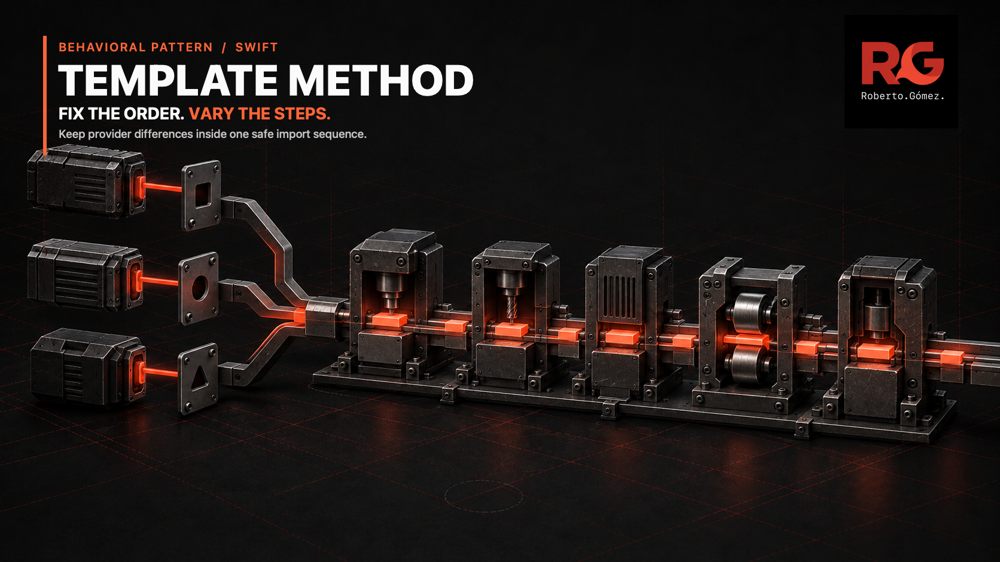
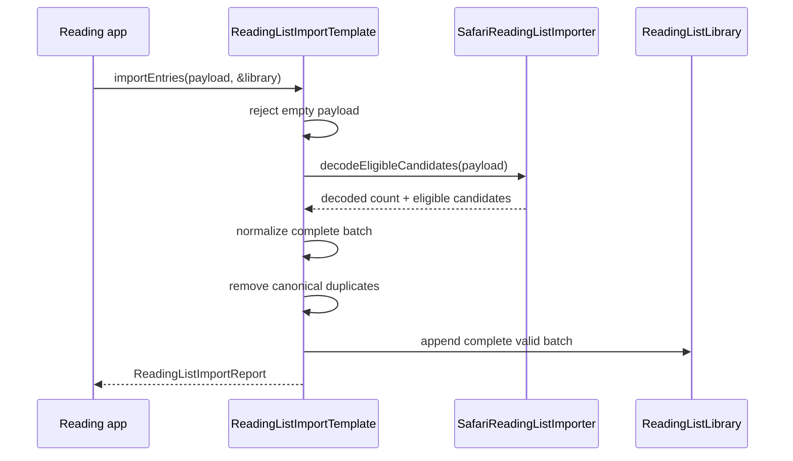

# 🛤️ Template Method



> **Caption:** Three provider-specific entrances join one fixed import rail,
> keeping normalization, deduplication, persistence, and reporting in order.

**Category:** Behavioral

## 🎯 The app problem

A reading app imports saved articles from Safari, Pocket, and Raindrop. Each
provider exports a different payload and has a different eligibility rule:

- Safari uses a property list and marks Reading List bookmarks.
- Pocket uses JSON and distinguishes unread from archived items.
- Raindrop uses JSON and keeps active articles while excluding links and
  removed items.

Once a provider has produced eligible candidates, every import must follow the
same safety-critical order: normalize the complete batch, remove canonical
duplicates, append atomically, and report accurate counts. An invalid URL must
leave the existing library unchanged.

### Requirements

- Reject empty input before provider decoding.
- Translate malformed payloads to a source-aware domain error.
- Let each provider own only decoding and candidate selection.
- Normalize schemes, hosts, fragments, root paths, default ports, and titles.
- Remove duplicates against stored entries and earlier records in the batch.
- Append only after every eligible candidate has normalized successfully.
- Build the report after persistence from the same decoded and eligible counts.

## 🪶 Start with direct Swift

[`ReadingListImportDirect.swift`](../../Sources/DesignPatterns/TemplateMethod/ReadingListImportDirect.swift)
starts with explicit `importSafariArchive`, `importPocketExport`, and later
`importRaindropExport` functions. Private helpers already centralize URL
normalization and duplicate detection.

That direct form is the right baseline for one or two providers. The order is
visible, provider payload types remain private, and there is no inheritance or
indirection to explain. Shared helpers alone are enough while copying the
orchestration is cheaper than owning a reusable skeleton.

The [problem definition](../../Documentation/template-method-problem.md)
records the original Safari and Pocket boundary.

## ⚡ The turning point

Raindrop adds a third public workflow. It repeats six invariant decisions
around two genuine variations:

1. validate before decoding;
2. translate provider decoding errors;
3. normalize the complete eligible batch;
4. deduplicate after normalization;
5. append atomically; and
6. build the source-aware report.

The risk is not line count. A future provider can accidentally append before
normalization finishes, skip canonical deduplication, or report counts from a
different stage. Tests can catch known failures, but the API still lets each
copied workflow choose its own order.

The [pressure evidence](../../Documentation/template-method-pressure.md)
measures the three copies and compares inheritance with protocol defaults,
ordinary function composition, and an enum switch.

## 🧭 Pattern intent

`ReadingListImportTemplate.importEntries(from:into:)` owns the invariant
algorithm. It is `final`, so provider importers cannot replace or reorder it.
The three subclasses vary one primitive operation:
`decodeEligibleCandidates(from:)`.

This boundary is deliberately closed. `ReadingListImportTemplate` is `public`
but not `open`, and its initializer plus hook are file-scoped. Consumers can
use the concrete provider importers through the base type, but cannot create a
new subclass or invoke the hook. A safe default maps an impossible missing hook
to `unreadablePayload`; the example does not simulate an abstract method with
`fatalError`.

## 🧩 Participants and responsibilities

| App role | Swift type | Responsibility |
| --- | --- | --- |
| Stable algorithm | [`ReadingListImportTemplate`](../../Sources/DesignPatterns/TemplateMethod/ReadingListImportTemplate.swift) | Validates, invokes the provider hook, normalizes, deduplicates, appends, and reports in one non-overridable order. |
| Safari variation | [`SafariReadingListImporter`](../../Sources/DesignPatterns/TemplateMethod/ReadingListImportTemplate.swift) | Decodes a property list and selects Reading List bookmarks. |
| Pocket variation | [`PocketReadingListImporter`](../../Sources/DesignPatterns/TemplateMethod/ReadingListImportTemplate.swift) | Decodes JSON and selects unread items. |
| Raindrop variation | [`RaindropReadingListImporter`](../../Sources/DesignPatterns/TemplateMethod/ReadingListImportTemplate.swift) | Decodes JSON and selects active articles. |
| Candidate boundary | `DecodedReadingListBatch` | Carries the decoded count and provider-selected candidates into the stable algorithm without exposing vendor payload types. |
| Mutable value | [`ReadingListLibrary`](../../Sources/DesignPatterns/TemplateMethod/ReadingListImportDirect.swift) | Stores unique entries and changes only after the whole eligible batch is valid. |
| Result | [`ReadingListImportReport`](../../Sources/DesignPatterns/TemplateMethod/ReadingListImportDirect.swift) | Reports source, decoded, eligible, inserted, and duplicate counts. |

There is no provider protocol, registry, repository, persistence abstraction,
or configurable stage graph. Three concrete importers are the complete,
immediate variation set.

## ⚙️ How the Swift implementation works

1. The app creates a concrete provider importer and can hold it as a
   `ReadingListImportTemplate`.
2. The final method rejects empty input before dynamic dispatch reaches the
   provider hook.
3. The subclass decodes its private payload projection, applies its eligibility
   rule, and returns only a decoded count plus neutral candidates.
4. The template normalizes every candidate before mutating the library. One
   invalid URL throws while the original value-semantic library is unchanged.
5. Canonical URLs are removed against both stored entries and earlier entries
   from the same batch.
6. The template appends the complete valid batch once and constructs the report
   from values produced by that same run.

The stable part is intentionally ordinary Swift:

```swift
public final func importEntries(
    from payload: Data,
    into library: inout ReadingListLibrary
) throws -> ReadingListImportReport {
    guard !payload.isEmpty else {
        throw ReadingListImportError.emptyPayload(source: source)
    }

    let batch = try decodeEligibleCandidates(from: payload)
    let normalizedEntries = try batch.candidates.map(normalize)
    let uniqueEntries = entriesNotAlreadyStored(
        normalizedEntries,
        in: library
    )
    library.append(contentsOf: uniqueEntries)

    return ReadingListImportReport(
        source: source,
        decodedRecordCount: batch.decodedRecordCount,
        eligibleRecordCount: batch.candidates.count,
        insertedCount: uniqueEntries.count,
        duplicateCount: normalizedEntries.count - uniqueEntries.count
    )
}
```

`ReadingListLibrary` remains a struct. The template class is stateless after
construction; inheritance owns algorithm selection, not shared mutable session
state. The synchronous `inout` operation cannot cross an `await`, and these
class instances are not declared `Sendable`. A concurrent import feature would
need an actor or another explicit owner around the library rather than an
unchecked conformance on this example.

## 🗺️ Diagram



The template and Safari lifelines represent two roles of the same importer
instance: the final inherited method calls the provider override, then resumes
the fixed sequence. Pocket and Raindrop take the same route through their own
decode-and-select override.

**Accessible description:** The reading app calls one final import operation.
That operation rejects empty data, asks the Safari subclass to decode and select
candidates, normalizes the entire batch, removes duplicates, appends once, and
returns a report. Pocket and Raindrop replace only the decode-and-select step.

## ▶️ Run the example

From the repository root, using Swift 6 on macOS 14 or later:

```sh
swift build -Xswiftc -warnings-as-errors
swift test -Xswiftc -warnings-as-errors --filter TemplateMethod
```

The package is a library. Tests supply realistic property-list and JSON payloads
and inspect the resulting value-semantic library and report; there is no console
executable.

## 🧪 Tests

[`TemplateMethodTests.swift`](../../Tests/DesignPatternsTests/TemplateMethodTests.swift)
verifies all three concrete variations through the final skeleton, title and URL
normalization, provider filtering, stored and in-batch deduplication, atomic
failure, and source-aware validation and decoding errors.

The same filter also runs
[`TemplateMethodProblemTests.swift`](../../Tests/DesignPatternsTests/TemplateMethodProblemTests.swift)
and
[`TemplateMethodPressureTests.swift`](../../Tests/DesignPatternsTests/TemplateMethodPressureTests.swift),
so the direct baseline and the third-provider pressure remain executable.

```sh
swift test -Xswiftc -warnings-as-errors
```

The full suite checks that this inheritance boundary compiles beside every
other catalogue example with warnings treated as failures.

## ⚖️ Trade-offs

### What improves

- Six repeated orchestration decisions now have one owner.
- The public import method cannot be overridden or reordered by a provider.
- Provider payload projections remain private and domain errors remain stable.
- Atomic persistence follows structurally from normalizing before the only
  append site.
- Adding a fourth in-module provider requires one decode-and-select override,
  not a copied workflow.

### What it costs

- Three stateless operations become reference types with superclass coupling.
- Swift has no abstract classes, so the construction boundary must make the
  default hook unreachable during normal use and still fail safely if the
  implementation file is extended incorrectly.
- The file-scoped hook intentionally prevents applications from adding external
  provider subclasses.
- A new provider still needs a new compiled type and a review of the closed
  variation set.
- The synchronous class hierarchy does not solve library isolation or
  concurrent imports.

## 🔀 Alternatives considered

| Alternative | Prefer it when | Why it is not the final choice here |
| --- | --- | --- |
| Direct functions with shared helpers | There are one or two providers and their order is easy to review. | Three public workflows now copy six safety-rail decisions. |
| One ordinary function receiving closures | The variation is local, call-site configuration is useful, or external providers must be injected. | For three named built-in formats, closure bundles make source metadata and decoded counts less explicit than one narrow subclass hook. |
| Protocol with a default implementation | Value semantics and external conformance matter more than locking the algorithm. | A conformer can provide or shadow the operation, so the stable order remains a convention rather than the only entry point. |
| Enum switch | Provider coverage is small, closed, and best reviewed in one function. | The switch would couple every vendor payload projection and selection rule to the algorithm owner. |
| Strategy | The complete ranking or transformation behavior must be interchangeable at runtime. | Only one step varies here; the surrounding order must not vary. |
| Factory Method | The subclass must decide which product object to construct. | These subclasses decode candidates inside an algorithm; object creation is not the variation being modeled. |

## 🚫 When not to use it

- Keep direct functions while only one or two workflows share a few obvious
  helpers.
- Prefer an ordinary higher-order function when closures make the variation
  clearer and the stable algorithm can stay private.
- Prefer a protocol when consumers genuinely need to add external providers and
  replacing the whole operation is acceptable.
- Do not inherit merely to reuse normalization or deduplication; ordinary
  functions already express those policies better.
- Do not add optional hooks, lifecycle callbacks, asynchronous stages, retries,
  persistence adapters, or middleware until a verified requirement needs them.
- Do not use this synchronous template as actor isolation. Concurrent mutation
  needs an explicit concurrency boundary.

## 🗂️ Source map

- [`ReadingListImportTemplate.swift`](../../Sources/DesignPatterns/TemplateMethod/ReadingListImportTemplate.swift) — final skeleton and the three provider variations.
- [`ReadingListImportDirect.swift`](../../Sources/DesignPatterns/TemplateMethod/ReadingListImportDirect.swift) — direct baseline and shared domain values.
- [`TemplateMethodTests.swift`](../../Tests/DesignPatternsTests/TemplateMethodTests.swift) — final pattern behavior and invariant-order evidence.
- [`TemplateMethodProblemTests.swift`](../../Tests/DesignPatternsTests/TemplateMethodProblemTests.swift) and [`TemplateMethodPressureTests.swift`](../../Tests/DesignPatternsTests/TemplateMethodPressureTests.swift) — executable baseline and pressure history.
- [`template-method-problem.md`](../../Documentation/template-method-problem.md) and [`template-method-pressure.md`](../../Documentation/template-method-pressure.md) — requirements, duplication count, and decision boundary.
- [`template-method-header.png`](../../Documentation/Assets/Patterns/behavioral/template-method-header.png) — editorial header.
