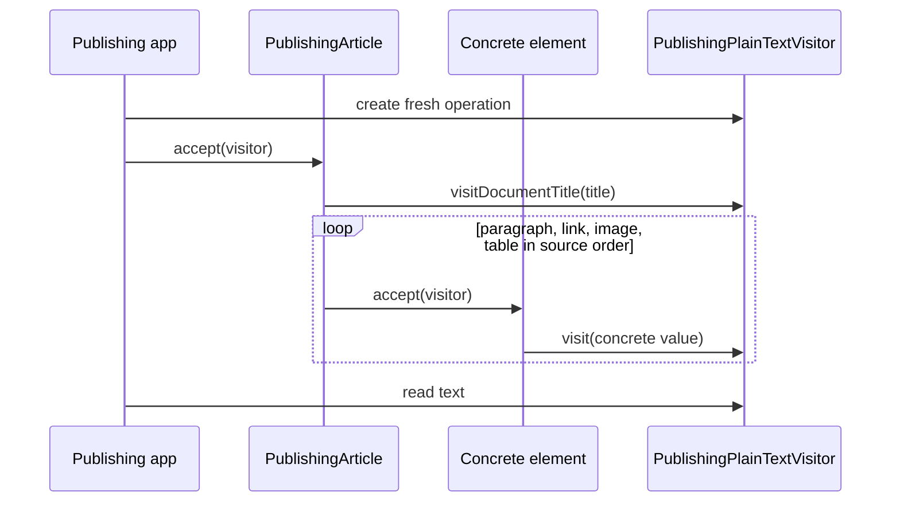

# 🔎 Visitor


> **Caption:** Three publishing operations traverse the same four stable
> document elements without rebuilding concrete-type dispatch in each one.

**Category:** Behavioral

## 🎯 The app problem

A city-guide publishing app represents an article with paragraphs, links,
images, and tables. Editors now need three whole-document operations whose
rules differ by concrete element:

- accessibility auditing returns ordered, typed findings and remembers the
  previous heading level;
- plain-text extraction creates search and share copy while excluding
  decorative images; and
- localization inventory records authored strings together with their node,
  asset, row, and column metadata.

The four element kinds have remained fixed while independent operations have
grown. Each operation must preserve article order, but they must not share
policy: decorative alternative text is excluded from plain text, inventoried
for localization when present, and reported by accessibility as redundant.

### Requirements

- Keep paragraph, link, image, and table values immutable and `Sendable`.
- Traverse an article in source order and preserve operation-owned state.
- Dispatch to behavior specialized for the concrete element without casts.
- Keep accessibility, text, and localization results independent.
- Add another whole-document operation without editing existing elements.
- Make the cost of adding a fifth element kind explicit.

## 🪶 Start with direct Swift

[`PublishingDocumentDirect.swift`](../../Sources/DesignPatterns/Visitor/PublishingDocumentDirect.swift)
models document nodes as a four-case `PublishingDocumentNode` enum. One
`DirectDocumentAccessibilityAuditor` loop and one exhaustive switch are the
smallest correct design for the initial requirement.

That version remains preferable with one or two operations. The switch is
local, value semantics are obvious, and the compiler identifies every place
that must handle a new node case. Visitor would only distribute a decision that
one function already expresses clearly.

The [problem definition](../../Documentation/visitor-problem.md) records that
baseline and its accessibility invariants.

## ⚡ The turning point

[`PublishingDocumentPressure.swift`](../../Sources/DesignPatterns/Visitor/PublishingDocumentPressure.swift)
adds plain-text extraction and localization inventory without changing the four
node kinds. The direct implementation now contains:

| Pressure signal | Direct implementation |
| --- | ---: |
| Whole-document operations | 3 |
| Ordered traversals | 3 |
| Exhaustive node switches | 3 |
| Concrete case branches | 12 |
| Node kinds | 4 |

The repeated detail is concrete-type selection, not the operations' different
rules or result shapes. A fourth operation would add another traversal and four
branches. A fifth node kind would deliberately be expensive either way because
every existing operation must define its behavior for that new kind.

The [pressure review](../../Documentation/visitor-pressure.md) compares the
enum with protocol requirements, a four-closure fold, free functions, and
Visitor before accepting the new boundary.

## 🧭 Pattern intent

Visitor moves concrete-element dispatch into the stable elements and keeps each
external operation in one cohesive type. `PublishingArticle.accept(_:)` walks
the elements. Every element's `accept` implementation calls the matching
overload on `PublishingDocumentVisiting`.

That two-step call is the double dispatch:

1. the runtime selects the concrete element's `accept` implementation; and
2. that implementation selects `visit(_:)` for its own concrete value.

The operation no longer switches or casts. The element does not learn any
accessibility, extraction, or localization policy.

## 🧩 Participants and responsibilities

| App role | Swift type | Responsibility |
| --- | --- | --- |
| Element operation contract | [`PublishingDocumentVisiting`](../../Sources/DesignPatterns/Visitor/PublishingDocumentVisitor.swift) | Declares title handling and one overload for each stable concrete element. |
| Visitable element | [`PublishingDocumentElement`](../../Sources/DesignPatterns/Visitor/PublishingDocumentVisitor.swift) | Exposes one `accept` entry point without prescribing an operation result. |
| Concrete elements | `PublishingParagraph`, `PublishingLink`, `PublishingImage`, `PublishingTable` | Preserve domain data and forward themselves to the matching visitor overload. |
| Ordered structure | [`PublishingArticle`](../../Sources/DesignPatterns/Visitor/PublishingDocumentVisitor.swift) | Visits the title, then each element in source order. |
| Accessibility operation | [`PublishingAccessibilityVisitor`](../../Sources/DesignPatterns/Visitor/PublishingDocumentVisitor.swift) | Accumulates typed findings and owns previous-heading state. |
| Text operation | [`PublishingPlainTextVisitor`](../../Sources/DesignPatterns/Visitor/PublishingDocumentVisitor.swift) | Accumulates normalized search and share lines. |
| Localization operation | [`PublishingLocalizationVisitor`](../../Sources/DesignPatterns/Visitor/PublishingDocumentVisitor.swift) | Accumulates strings with source metadata. |

The three concrete visitors are reference types because each traversal owns a
mutable accumulator with a different result type. Elements and articles remain
immutable values. There is no superclass, generic result algebra, type erasure,
registry, dependency container, asynchronous layer, or shared global visitor.

## ⚙️ How the Swift implementation works

1. The app creates one fresh visitor for one operation.
2. `PublishingArticle.accept(_:)` gives it the title and walks elements in
   source order.
3. The existential element call selects the concrete `accept` implementation.
4. That implementation forwards its concrete value to the corresponding
   visitor overload.
5. The visitor applies only its own policy and updates only its own state.
6. After traversal, the caller reads `report`, `text`, or `entries`.

The double-dispatch boundary is intentionally small:

```swift
public protocol PublishingDocumentElement: Sendable {
    func accept(_ visitor: any PublishingDocumentVisiting)
}

extension PublishingImage: PublishingDocumentElement {
    public func accept(_ visitor: any PublishingDocumentVisiting) {
        visitor.visit(self)
    }
}
```

A new outbound-link operation conforms to `PublishingDocumentVisiting` and
implements the existing overload set; no element changes. In the opposite
direction, a new video element must add a visitor requirement and behavior to
all existing visitors. That asymmetry is the reason to use Visitor only while
element kinds are more stable than operations.

Each concrete visitor is single-use. Reusing one instance would append a second
article's result and carry heading state across documents. A production API
could hide construction behind operation functions, but three tiny factories
would add no teaching value here. Concurrent traversal would require one
visitor per task or explicit isolation; these mutable visitor classes are not
`Sendable`.

## 🗺️ Diagram



Observe the two runtime decisions inside the loop: the article reaches the
concrete element through `accept`, then that element reaches its specific
visitor overload. Accessibility and localization follow the same sequence with
their own state and result.

**Accessible description:** The publishing app creates a plain-text visitor and
passes it to the article. The article first sends its title to the visitor. It
then visits each paragraph, link, image, and table in source order. Each concrete
element accepts the visitor and invokes the overload for its own type. After the
walk, the app reads the accumulated text. The other two operations use the same
element path but separate visitors.

## ▶️ Run the example

From the repository root, using Swift 6 on macOS 14 or later:

```sh
swift build -Xswiftc -warnings-as-errors
swift test -Xswiftc -warnings-as-errors --filter Visitor
```

The package is a library. Tests construct publishing articles, run visitors,
and inspect typed results; no executable app or console output is required.

## 🧪 Tests

[`VisitorTests.swift`](../../Tests/DesignPatternsTests/VisitorTests.swift)
verifies:

- concrete overload dispatch for all four elements in source order;
- a fourth outbound-link operation without any element modification;
- accessibility finding order and cross-element heading state;
- a complete article with no accessibility findings;
- plain-text ordering and decorative-image exclusion; and
- localization metadata with blank authored copy omitted.

The same filter also runs
[`VisitorProblemTests.swift`](../../Tests/DesignPatternsTests/VisitorProblemTests.swift)
and [`VisitorPressureTests.swift`](../../Tests/DesignPatternsTests/VisitorPressureTests.swift),
so the direct enum baseline and measured pressure remain executable evidence.
The final implementation does not make the direct alternative artificially
fail or disappear.

## ⚖️ Trade-offs

### What improves

- Three operation-owned switches become one stable double-dispatch boundary.
- A new operation is one cohesive visitor and does not edit existing elements.
- Different accumulators and cross-element state remain local to their operation.
- There are no casts, string type tags, or shared conditional pipeline.

### What it costs

- Two protocols, four `accept` implementations, and one indirect call per
  visited element.
- The visitor protocol lists the complete element set, coupling every visitor
  to that closed family.
- A new element kind changes the protocol and every existing visitor.
- Stateful visitors have a one-traversal lifetime and are not automatically
  safe to share across concurrent tasks.
- Protocol existentials mean `PublishingArticle` does not gain synthesized
  `Equatable`; this example compares observable operation results instead.

## 🔀 Alternatives considered

| Alternative | Prefer it when | Why Visitor wins here |
| --- | --- | --- |
| Exhaustive enum switches | The node set or operation set is small and compiler-local exhaustiveness is the clearest maintenance model. | Three growing operations already repeat twelve branches over four unchanged node kinds. |
| Protocol requirements on elements | The behavior is an intrinsic capability or invariant of every element. | Accessibility, search text, and localization are external publishing concerns with different policies. |
| Generic fold with four closures | Traversal is the only repetition and call sites stay smaller than full operations. | Stateful accessibility and structured localization make each four-closure call a second operation matrix. |
| Free functions per concrete value | Several operations genuinely share a transformation rule. | Helpers reduce rule duplication but not repeated concrete-type selection. |
| Iterator | Clients need controlled access to an ordered collection. | Iterator chooses how values are produced; it does not dispatch behavior by each concrete element type. |
| Strategy | One interchangeable algorithm should handle the same input contract. | These operations coexist, produce unrelated result types, and each specializes across four element types. |
| Composite | Individual and nested containers need one uniform operation. | This article has a flat, fixed element family; the pressure is adding external operations, not recursive structure. |

## 🚫 When not to use it

- Keep the enum and exhaustive switches while they remain easier to understand.
- Do not use Visitor when element kinds change as often as operations; its
  extension direction will work against the product.
- Keep intrinsic behavior as a protocol requirement or method beside its data.
- Prefer a fold when one small traversal abstraction removes the repetition.
- Do not add a visitor to avoid four obvious branches in one function.
- Do not share a mutable visitor across articles, tasks, or actors without an
  explicit reset and isolation policy.
- Do not erase result types into `Any` merely to make one universal visitor API.

## 🗂️ Source map

- [`PublishingDocumentVisitor.swift`](../../Sources/DesignPatterns/Visitor/PublishingDocumentVisitor.swift) — final element contract, double dispatch, and three visitors.
- [`PublishingDocumentDirect.swift`](../../Sources/DesignPatterns/Visitor/PublishingDocumentDirect.swift) — node values, findings, and the initial direct audit.
- [`PublishingDocumentPressure.swift`](../../Sources/DesignPatterns/Visitor/PublishingDocumentPressure.swift) — direct extraction and localization comparison.
- [`VisitorTests.swift`](../../Tests/DesignPatternsTests/VisitorTests.swift) — final dispatch, behavior, and extension-direction evidence.
- [`visitor-problem.md`](../../Documentation/visitor-problem.md) and [`visitor-pressure.md`](../../Documentation/visitor-pressure.md) — evidence that earned the pattern.
- [`visitor-header.png`](../../Documentation/Assets/Patterns/behavioral/visitor-header.png) — editorial header.
