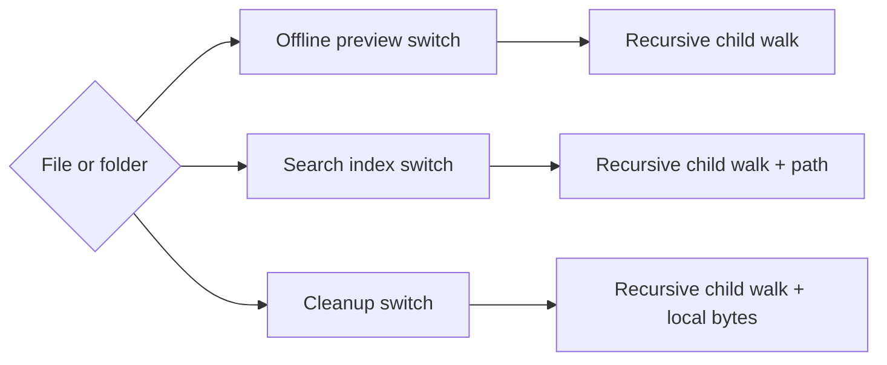

# Composite Pressure: Repeated Workspace Traversal

Pressure-review date: 2026-10-11

Internal Day 065 adds two credible consumers to the offline workspace from Day
064. Search indexing needs a stable depth-first list with complete folder paths.
Storage cleanup needs the bytes occupied by files that are currently stored
offline, even when a file can no longer be downloaded.

The direct enum still models the closed hierarchy well. The pressure appears in
clients: each operation must switch between file and folder, recurse through
children, and decide how each visited file contributes to its result.

## New product requirements

The app now supports three operations over the same selection:

1. The offline preview counts files, totals bytes, and blocks a selection when
   one file is restricted.
2. Search indexing emits one record per file with its full display path.
3. Storage cleanup totals only files already stored on the device.

The cleanup rule deliberately differs from download permission. A restricted
file may still occupy local storage after access changes, and the cleanup screen
must count those bytes even though the offline preview would reject a fresh
download. Composite may centralize traversal, but it must not merge these
consumer policies.

## Direct implementation under pressure

[`WorkspaceOfflinePressure.swift`](../Sources/DesignPatterns/Composite/WorkspaceOfflinePressure.swift)
adds two concrete clients without a shared component abstraction:

- `DirectWorkspaceSearchIndexer` carries folder names while recursively
  visiting entries and builds depth-first `WorkspaceSearchRecord` values.
- `DirectWorkspaceCleanupPreview` recursively adds bytes only for leaves whose
  `isStoredOffline` flag is true.

The original `DirectOfflineSelectionPreview` remains unchanged. That is useful
evidence: no single client is especially complicated, and each policy is easy
to audit in isolation. The problem is that hierarchy mechanics now have three
owners.

## Measured duplication

| Signal | Day 064 | Day 065 |
| --- | ---: | ---: |
| Recursive client operations | 1 | 3 |
| File-or-folder switches | 1 | 3 |
| Folder child traversals | 1 | 3 |
| Clients recursively visiting every descendant | 1 | 3 |
| Distinct leaf policies | 1 | 3 |

The three leaf policies must remain distinct:

- offline preview combines size with download permission;
- search indexing builds identity and path records regardless of permission;
- cleanup ignores download permission and checks current local storage.

Moving those rules into one large recursive helper would reduce switch count by
creating a multi-purpose traversal with flags, optional accumulators, or
callbacks. That would hide ownership rather than improve it.

## Acceptance evidence

[`CompositePressureTests.swift`](../Tests/DesignPatternsTests/CompositePressureTests.swift)
verifies that:

- search records preserve depth-first workspace order;
- nested folder names produce complete display paths;
- a top-level file does not gain a fictional parent folder;
- cleanup includes only files stored offline; and
- a restricted file remains reclaimable when it already occupies local space.

Run both direct stages with:

```sh
swift test -Xswiftc -warnings-as-errors --filter Composite
```

## Pressure flow



Observe the repeated structural decision rather than the different outputs.
Every client asks whether the entry is a file or folder and owns another
recursive walk. An accessible equivalent is: one hierarchy fans out to three
clients; each client repeats the same branch and recursion, then applies its own
leaf-specific policy.

## Why Composite is now justified

The pressure is structural and measured. A minimal component boundary can let a
file yield itself and a folder recursively yield its descendants. Clients can
then map, filter, or reduce the resulting files without knowing whether their
input was a leaf or a nested container.

Day 066 should introduce only that uniform traversal:

- one `WorkspaceComponent` operation shared by file and folder;
- one leaf implementation returning itself;
- one folder implementation delegating to children;
- consumer policies remaining outside the component;
- file-only actions accepting `WorkspaceFile`, not the common component; and
- no parent links, mutable tree API, visitor, generic reducer, or type erasure
  wrapper beyond Swift's protocol existential.

## Day 065 decision

Composite has earned consideration because three clients now duplicate the
file-or-folder branch and recursive walk. It has not earned control over search,
offline permission, cleanup policy, or file opening. The smallest useful pattern
will centralize only how descendants are reached.
