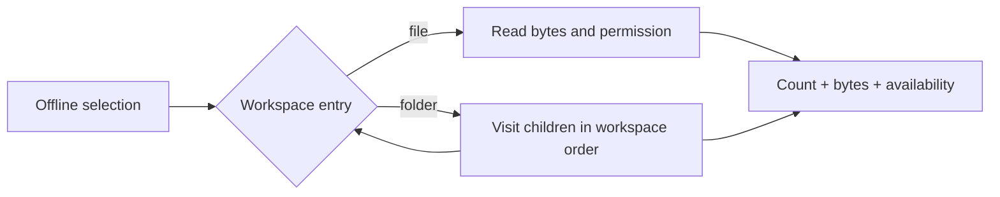

# Composite Problem: Offline Workspace Hierarchy

Problem-definition date: 2026-10-11

Internal Day 064 defines a direct hierarchy baseline for a field-service app.
Its shared workspace contains files and folders, and folders may contain both
files and other folders. Before making either kind of entry available offline,
the app needs the same preview: leaf count, total bytes, and whether the entire
selection can be downloaded.

One offline-selection screen currently owns that recursive walk. Swift's
`indirect enum` keeps the closed file-or-folder choice exhaustive, so a
Composite protocol would add an extension boundary before the app has
demonstrated that it needs one.

## Product scenario

A field engineer selects a project folder before travelling to a site with poor
connectivity. A visit folder may contain a briefing folder, inspection plans,
safety videos, and checklists. The preview must show how many files and bytes
will be stored, and it must block the complete selection when any nested file
is restricted from offline use.

An empty folder is also not downloadable: it represents an unfinished workspace
section, not useful offline content. The preview still reports the count and
size of restricted files so the UI can explain the selection rather than
silently omitting material.

This teaching unit covers an in-memory workspace, one preview consumer, byte
counts, arbitrary folder depth, and current download permission. File contents,
partial downloads, sync conflicts, encryption, remote loading, filesystem URLs,
and cycle detection are outside today's scope.

## Requirements and invariants

| Requirement | Observable behavior |
| --- | --- |
| File preview | One file contributes one leaf and its byte count. |
| File permission | A restricted file makes that selection unavailable offline. |
| Nested folder | Every descendant file contributes exactly once. |
| Total size | File sizes are added without flattening the stored hierarchy. |
| Folder permission | One restricted descendant blocks the whole folder. |
| Empty folder | It reports zero files and bytes but remains unavailable. |

The direct hierarchy also preserves these constraints:

1. A file cannot have an empty identifier or name, or a negative byte count.
2. A folder has a domain name and stores its children in workspace order.
3. Only files contribute to the leaf count and byte total.
4. Nesting does not change a file's size or download permission.
5. The preview computes a value and does not mutate the workspace hierarchy.

## Direct Swift first

[`WorkspaceOfflineDirect.swift`](../Sources/DesignPatterns/Composite/WorkspaceOfflineDirect.swift)
uses `WorkspaceFile` and `WorkspaceFolder` as domain values. The recursive
`DirectWorkspaceEntry` enum closes the hierarchy to exactly two cases. That
choice gives the compiler an exhaustive switch and allows folders to contain
other entries without reference semantics.

`DirectOfflineSelectionPreview.summary(for:)` branches once. A file becomes a
one-leaf summary. A nonempty folder reduces the summaries of its children,
adding file counts and byte sizes while combining download permission. An empty
folder returns an explicit unavailable summary instead of inheriting the
mathematically true but product-inappropriate result of `allSatisfy` on an empty
collection.

There is no common component protocol, leaf protocol, container interface,
type erasure, visitor, parent pointer, mutable tree, repository, or download
service. With one operation and one client, the recursive enum is shorter and
more explicit than a Composite object graph.

## Acceptance tests

[`CompositeProblemTests.swift`](../Tests/DesignPatternsTests/CompositeProblemTests.swift)
uses Swift Testing to verify:

- one file produces a one-leaf downloadable preview;
- a folder nested two levels deep aggregates every file exactly once;
- one restricted leaf blocks the complete selection without removing its count
  or byte size; and
- an empty folder is unavailable with a zero-value summary.

Run the focused suite with:

```sh
swift test -Xswiftc -warnings-as-errors --filter CompositeProblemTests
```

## Initial hierarchy flow



Observe where the branching lives: the offline screen must identify file and
folder cases, and a folder sends each child back through the same decision. An
accessible equivalent is: the preview reads a file directly; for a folder, it
recursively repeats the file-or-folder decision for every child and then
combines all child summaries.

## Evidence to gather on Day 065

The hierarchy is real, but Composite has not earned a new abstraction from one
recursive client. Day 065 will add credible workspace operations and measure
whether the enum switch and traversal begin leaking into multiple consumers:

- Add a search-index projection that needs every visible file.
- Add a storage-cleanup preview that totals local bytes under any entry.
- Count repeated file-or-folder switches and recursive walk functions.
- Verify every operation preserves hierarchy order and appropriate permission
  rules.
- Keep leaf-only actions, such as opening an individual file, out of any
  proposed uniform tree operation.

Only repeated hierarchy mechanics should move behind a Composite boundary.
Offline presentation, search indexing, cleanup policy, and file opening remain
consumer responsibilities.

## Initial editorial thesis

**Thesis:** A folder should become available offline like one selection without
hiding the files that determine its storage cost and permission.

**Scene:** A matte-black project archive sits open across the lower frame. One
single document cartridge enters from the left; beside it, a larger folder
housing is cut open to reveal a smaller fitted folder and two document modules.
Warm-red rails connect every nested compartment to one offline storage bay on
the lower-right, where three restrained indicators represent files, bytes, and
permission. The structure reads left to right and uses no screens, labels,
generic cloud icons, floating dashboards, people, or decorative circuits.

The final Day 066 header should keep this nested-archive metaphor only if
measured client pressure justifies a uniform component boundary. It must follow
[`visual-style.md`](visual-style.md); no header asset is generated during problem
definition.

## Day 064 decision

The nested workspace requirement is executable, but an `indirect enum` and one
recursive preview function remain the clearest design. Composite stays a
hypothesis until another operation or extension boundary makes clients repeat
the file-or-folder distinction.
