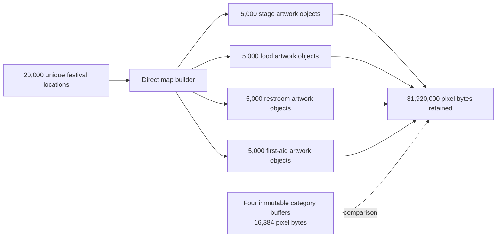

# Flyweight Pressure: 20,000 Pins Repeat Four Marker Resources

Pressure-review date: 2026-10-18

Internal Day 075 exercises the direct festival-map builder from Day 074 with
20,000 deterministic locations distributed evenly across four categories. The
implementation still constructs one complete artwork object and one decoded
32 × 32 RGBA buffer for every annotation. There is no cache, lookup key, shared
resource, or Flyweight implementation yet.

The result makes one narrow question answerable with exact counts: is the
repeated immutable pixel payload large enough to justify evaluating shared
category artwork?

## Representative workload

[`FlyweightPressureTests.swift`](../Tests/DesignPatternsTests/FlyweightPressureTests.swift)
generates 20,000 locations because the product scenario includes temporary
venues, facilities, sponsor activations, and programme events across a large
multi-day site. The fixture:

- cycles evenly through main stage, food court, restroom, and first aid;
- preserves a unique identifier, name, coordinate, and crowd status per pin;
- runs the production-like direct builder rather than a formula-only mock; and
- retains the complete annotation result while its resource identities and
  pixel payload are counted.

This is a deterministic capacity fixture, not a timing benchmark. Wall-clock
time would vary with hardware and build configuration and would not answer the
ownership question.

## Direct measurement boundary

[`FestivalMapPressure.swift`](../Sources/DesignPatterns/Flyweight/FestivalMapPressure.swift)
adds `profiledAnnotations(for:)` to the existing direct builder. It first builds
the ordinary annotations, then reports:

- the number of annotations and decoded-icon constructions;
- distinct `DirectFestivalMarkerArtwork` identities globally and per category;
- the exact number of bytes in every decoded pixel buffer;
- the minimum pixel payload if each used category owned one equivalent buffer;
  and
- the difference between those two payload counts.

The profile intentionally excludes object headers, `Array` capacity, allocator
rounding, strings, colors, process RSS, UI framework caches, and renderer-owned
copies. Swift and Apple UI implementations may represent those costs
differently. The pixel count is exact for this code and is the conservative,
portable pressure this example can defend.

## Measured pressure

| Evidence | Direct result | Four-category minimum | Difference |
| --- | ---: | ---: | ---: |
| Artwork objects | 20,000 | 4 | 19,996 |
| Decoded-icon constructions | 20,000 | 4 | 19,996 |
| Pixel payload | 81,920,000 bytes | 16,384 bytes | 81,903,616 bytes |
| Pixel payload in MiB | 78.125 MiB | 0.015625 MiB | 78.109375 MiB |

Each category contributes 5,000 distinct artwork identities and 20,480,000
pixel bytes. Sharing one immutable resource per category could therefore avoid
99.98% of this decoded pixel payload for the representative map. The direct
result also performs 19,996 redundant icon constructions beyond the minimum.

The comparison is not claiming that a future implementation will reduce total
process memory by exactly 78.109375 MiB. It establishes that the direct
ownership model itself retains that much avoidable repeated pixel content
before framework and allocator overhead are considered.

## Executable evidence

The pressure suite verifies that:

- all 20,000 locations produce annotations and distinct artwork objects;
- direct pixel bytes equal `20,000 × 4,096`;
- the four-category minimum equals `4 × 4,096`;
- every category owns 5,000 distinct objects and 20,480,000 pixel bytes;
- a two-location feed using two categories has no repeated category payload;
  and
- an empty feed reports zero objects, bytes, and categories.

Run the Flyweight problem and pressure suites from the repository root:

```sh
swift test -Xswiftc -warnings-as-errors --filter Flyweight
```

## Pressure map



Observe that unique location state is not the measured problem. Four branches
reconstruct 5,000 identical resources each and converge on 81,920,000 retained
pixel bytes, while four category buffers would contain the same intrinsic
pixels in 16,384 bytes. An accessible equivalent is: 20,000 unique festival
locations enter the direct builder; each of four categories creates 5,000
separate artwork objects, producing nearly 78.11 MiB of repeated pixel payload
beyond one buffer per category.

## Alternatives considered before Flyweight

| Alternative | When it is enough | Why it does not remove today's measured pressure |
| --- | --- | --- |
| Keep the direct builder | Small maps, short-lived annotations, or a UI framework proven to deduplicate decoded images. | This fixture retains 20,000 distinct resource objects and 78.109375 MiB of avoidable pixel content. |
| Store compressed image data per annotation | Decode cost or transport size dominates and annotations do not need ready-to-render pixels. | It moves the representation boundary but still repeats one payload per pin and may shift decoding into rendering. |
| Let the map framework reuse annotation views | View churn is the actual bottleneck. | Reusable views do not guarantee that model-owned artwork buffers are shared. |
| Use an asset name instead of decoded pixels | The rendering API already resolves and caches named assets with documented ownership. | That would be the simpler production choice, but this example's explicit decoded-buffer boundary does not provide it. |
| Share four immutable category resources | Many live annotations repeat a small, stable category set. | This removes the measured repetition but introduces lookup and lifetime rules that Day 076 must keep minimal. |

Before adopting Flyweight in a real app, profile the real renderer. If
`UIImage`, `NSImage`, the asset catalogue, or the map SDK already shares decoded
resources, another cache would duplicate infrastructure and may retain memory
longer than necessary.

## Boundary carried into Day 076

The next day may share intrinsic category artwork only if it:

- keeps identifiers, titles, coordinates, status, and accessible labels on
  each annotation;
- creates at most one immutable artwork resource per used category;
- preserves deterministic appearance and stable feed order;
- records the same pixel counts so the before-and-after benefit is executable;
- uses an exhaustive category key without a generic cache protocol, eviction
  policy, weak table, actor, repository, or renderer abstraction; and
- documents lookup, lifetime, and test-isolation costs alongside the saving.

## Day 075 decision

Flyweight has earned consideration: a representative direct result retains
81,903,616 pixel bytes that would be unnecessary with one immutable buffer per
category. It has not been implemented today. Day 076 must prove that a tiny,
category-keyed shared representation removes that pressure without obscuring
the per-location state or inventing cache infrastructure the example does not
need.
