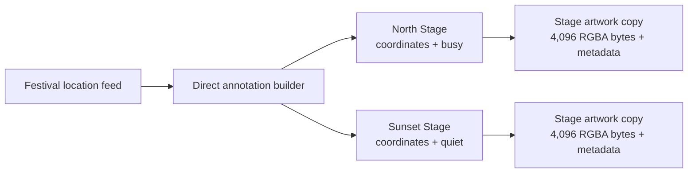

# Flyweight Problem: Festival Map Annotations

Problem-definition date: 2026-10-17

Internal Day 074 defines a direct annotation baseline for a multi-day festival
map. Every venue has unique coordinates, name, and crowd status, while venues in
the same category repeat the same decoded marker pixels, colors, category label,
and accessibility hint.

The map currently builds one complete annotation for every location. That is
the clearest ownership model: a caller receives ordinary annotation values and
does not know about caches, keys, pools, or shared marker resources. Flyweight
remains a hypothesis until representative measurements show that repeated
immutable artwork is a material memory cost.

## Product scenario

A festival companion app renders stages, food courts, restrooms, and first-aid
points across a large outdoor site. The live feed can contain tens of thousands
of map locations when temporary bars, sponsor activations, water stations, and
individual programme events are included. Coordinates and crowd status change
per location, but each category uses one approved visual and accessibility
vocabulary.

The rendering boundary expects decoded 32 × 32 RGBA marker pixels. The direct
builder therefore materializes a fresh 4,096-byte pixel buffer for every map
annotation, just as a naive Apple-platform integration might decode the same
asset into a new image object for each annotation view. Category colors and
accessibility guidance travel with that complete resource.

This teaching unit covers deterministic in-memory annotation creation, four
venue categories, current crowd state, category metadata, and stable source
order. Map clustering, viewport queries, image files, live networking, spatial
indexes, annotation reuse, UI rendering, localization, and data races are
outside today's scope.

## Requirements and invariants

| Requirement | Observable behavior |
| --- | --- |
| Unique map state | Every annotation preserves its location identifier, title, coordinates, and crowd status. |
| Stable ordering | Output order matches the festival feed order. |
| Category appearance | Marker pixels, fill, border, label, and hint are deterministic for each category. |
| Accessible summary | The label combines the unique venue name with its category and current status. |
| Complete resource | Every annotation receives its own artwork object and decoded pixel buffer. |
| Empty feed | No locations produce no annotations or auxiliary state. |

The direct builder also preserves these constraints:

1. Location identifiers and names cannot be empty.
2. Latitude stays within -90...90 and longitude within -180...180.
3. Every decoded icon contains 32 × 32 pixels with four RGBA bytes per pixel.
4. Locations in the same category receive equal artwork values but distinct
   artwork identities.
5. Different categories receive different pixel content and metadata.
6. Per-location state never leaks into category artwork.

## Direct Swift first

[`FestivalMapDirect.swift`](../Sources/DesignPatterns/Flyweight/FestivalMapDirect.swift)
models feed data with `FestivalMapLocation` and output with
`DirectFestivalMapAnnotation`. `DirectFestivalMapBuilder` maps the input once,
selects a category descriptor with an exhaustive enum switch, decodes a fresh
marker buffer, and assembles the accessible label.

`DirectFestivalMarkerArtwork` is an immutable reference because decoded images
in Apple UI stacks are reference-like resources. The direct builder creates a
new instance for every annotation. This makes the ownership and the repeated
work observable without smuggling in storage sharing through Swift collection
copy-on-write behavior.

There is no artwork cache, flyweight factory, marker key, registry, protocol,
weak-reference table, eviction policy, renderer abstraction, repository, or
actor. One enum switch remains a more honest baseline than a pattern whose
benefit has not yet been measured.

## Acceptance tests

[`FlyweightProblemTests.swift`](../Tests/DesignPatternsTests/FlyweightProblemTests.swift)
uses Swift Testing to verify:

- feed order, coordinates, and crowd state survive annotation creation;
- category-specific pixels and accessibility metadata are deterministic;
- two stages receive equal artwork values through distinct resource identities;
  and
- an empty feed needs no special state.

Run the focused suite with:

```sh
swift test -Xswiftc -warnings-as-errors --filter FlyweightProblemTests
```

## Initial repetition map



Observe the two separate artwork destinations: the stages keep different map
state, but the builder reconstructs equivalent marker pixels and category
metadata for each annotation. An accessible equivalent is: one festival feed
enters the direct builder; North Stage and Sunset Stage leave with unique
coordinates and statuses, and each independently owns a complete copy of the
same stage artwork.

## Evidence measured on Day 075

The completed [pressure review](flyweight-pressure.md) measures the direct
builder with 20,000 locations: 20,000 distinct artwork objects retain
81,920,000 pixel bytes, of which 81,903,616 bytes repeat content beyond one
buffer for each of the four categories.

Visible repetition was not enough to earn Flyweight. Day 075 exercised a
representative large data set and distinguished the heavy intrinsic category
resource from the small per-location state:

- Build a deterministic feed containing tens of thousands of annotations.
- Calculate the bytes held by decoded pixel buffers in the direct result.
- Count resource identities per category and across the complete map.
- Compare repeated intrinsic bytes with the four-category minimum without yet
  replacing the direct implementation.
- Record construction work and the ownership assumptions behind the estimate.
- Reject Flyweight if the saving is immaterial or if the real UI framework
  already shares the decoded resources.

The pressure review uses explicit counts rather than a vague claim that many
objects are expensive. Cache lookup, lifecycle, thread safety, and eviction
remain costs to consider only after the memory evidence exists.

## Initial editorial thesis

**Thesis:** Ten thousand map pins should not need ten thousand copies of the
same four category markers.

**Scene:** A matte-black festival site model fills the lower frame from left to
right. Thousands of precise location stems rise from unique coordinates and
status rings, while visibly identical bulky marker cartridges are duplicated
above each stem. Four warm-red source moulds sit unused at the left edge,
suggesting that the repetition has not yet been consolidated. Use no screen UI,
map-provider branding, people, labels, floating dashboards, code, or decorative
circuits.

The final Day 076 header should retain this repeated-marker metaphor only if
Day 075 measures a meaningful reduction from shared immutable resources. It
must follow [`visual-style.md`](visual-style.md); no header asset is generated
during problem definition.

## Day 074 decision

The large annotation domain and repeated immutable artwork are executable, but
the direct builder is still the simplest design. Flyweight is not introduced
today: quantitative evidence must show that sharing category resources is worth
the lookup and lifetime rules.
