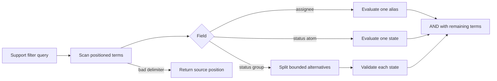

# Interpreter Pressure: One Group Changes the Language Boundary

Pressure-review date: 2026-10-24

Internal Day 082 adds one product request to the support inbox language from
Day 081: an agent can include several lifecycle states in one status term, as
in `status:(open|waiting) assignee:me`. OR is limited to values inside that
status group; separate terms remain conjunctive.

The feature looks like one extra condition, but it changes the input from a
flat list of field-value pairs into a language with opening, separator, and
closing tokens. A useful inline error must now identify where the malformed
input begins. The implementation remains hand-written and direct today so that
this parsing pressure is measured before an Interpreter object model appears.

## The requirement that changed

Support agents need a saved view containing both open and waiting tickets while
still restricting the result to their own queue. The bounded grammar becomes:

```text
query          = term *(whitespace term)
term           = status-term / assignee-term
status-term    = "status:" status-value
status-value   = status / "(" status *("|" status) ")"
status         = "open" / "waiting" / "closed"
assignee-term  = "assignee:" ("me" / "unassigned")
```

Spaces inside a group, nested groups, arbitrary assignee values, grouped
assignees, global OR, NOT, precedence, escaping, quoted strings, ranges, and
free text remain invalid. Repeated fields remain legal and conjunctive, so
`status:(open|waiting) status:closed` returns no matches rather than changing
the meaning of the query.

## Direct implementation under pressure

[`SupportTicketFilterPressure.swift`](../Sources/DesignPatterns/Interpreter/SupportTicketFilterPressure.swift)
keeps one scanning loop and direct field decisions. It records zero-based
character offsets, parses a status atom or one non-nested group, and applies the
result immediately to the remaining tickets.

The pressure version introduces no public token, lexer, AST, expression
protocol, recursive evaluator, parser combinator, visitor, registry, or
predicate closure graph. `Set<SupportTicketStatus>` is the smallest internal
representation needed for OR within one field. AND remains the order in which
terms filter the collection.

## Observable grammar pressure

| Signal | Day 081 | Day 082 |
| --- | ---: | ---: |
| Value shapes | one atom | atom or status group |
| Structural delimiters | field colon | colon, open, alternative, close |
| Composition scopes | query-wide AND | query-wide AND plus local OR |
| Source positions in failures | none | zero-based character offset |
| Grammar-specific failure families | 2 | 5 |
| Nested grammar levels | 0 | 0 |

The five grammar-specific failure families are a malformed term, missing value,
unclosed group, empty alternative, and unexpected delimiter. Field and value
vocabulary errors remain separate domain failures. This separation lets the UI
underline a syntax location without presenting an unsupported status as broken
punctuation.

One grouped value therefore adds three delimiter decisions and position
bookkeeping to the former field switch. That is enough to consider explicit
language structure on Day 083, but not enough to justify a general parser.

## Acceptance evidence

[`InterpreterPressureTests.swift`](../Tests/DesignPatternsTests/InterpreterPressureTests.swift)
verifies that:

- OR inside a status group composes with AND between terms;
- the filter preserves inbox order even when alternatives are written in a
  different order;
- repeated status terms retain conjunctive semantics;
- unclosed groups, empty alternatives, and ungrouped delimiters report exact
  character positions;
- grouped assignees are rejected at the value boundary; and
- an unsupported status reports its position inside the group.

Run both direct Interpreter stages with warnings treated as errors:

```sh
swift test -Xswiftc -warnings-as-errors --filter Interpreter
```

## Pressure flow



Observe where the language stops being flat: a status value can take one of two
shapes, and the grouped shape owns local OR while the outer query retains AND.
An accessible equivalent is: positioned terms branch by field; an assignee or
single status is evaluated directly, a grouped status validates each
alternative, every term narrows the result, and malformed delimiters return
their source position.

## Alternatives before Interpreter

| Alternative | Strength | Limit or decision under today's pressure |
| --- | --- | --- |
| Extend the direct scanner | All accepted punctuation and failure positions remain visible in one small file. | Each new composition level must repeat cursor, delimiter, and diagnostic rules. This is today's benchmark. |
| Parse into predicate closures | Evaluation can stay concise and closures compose naturally. | Closures do not preserve source structure for diagnostics, inspection, or a future query translation boundary. |
| Use a small internal enum | Named atom, group, and conjunction cases can retain structure without a class hierarchy. | It adds a second representation and only pays for itself if parsing and evaluation need separate evolution. This is the Day 083 candidate. |
| Use `NSPredicate` | Appropriate when an Objective-C-compatible model and platform query consumer already require it. | Stringly typed key paths and platform expression semantics are a poorer fit for this value-semantic, bounded Swift vocabulary. |
| Send typed server query parameters | Avoids a client language when the backend owns all filtering and composition. | This example must evaluate saved views locally against an already loaded inbox. |
| Adopt a maintained parser library | Provides tested combinators or grammar tooling when recursion, precedence, recovery, and richer tokens arrive. | One non-nested group would add a dependency and abstraction larger than the current grammar. |

Adding only another field or a flat set-membership value would not earn
Interpreter. A dictionary of field predicates would be the smaller change when
all terms remain independent atoms.

## Parser-library threshold

Stop extending the hand-written parser and evaluate a maintained parsing
library when any of these become real product requirements:

- nested groups or parentheses that require recursive parsing;
- both AND and OR at multiple levels, with precedence or associativity;
- quoted or escaped values whose token boundaries no longer follow whitespace;
- error recovery that must report several diagnostics in one edit; or
- a grammar that is shared with, generated from, or must stay compatible with
  another client or server implementation.

At that point, tokenization, recursion, and recovery are infrastructure rather
than the teaching focus. A parser library can own those mechanics while the app
still owns domain expressions and evaluation.

## Boundary carried into Day 083

Interpreter may replace the pressure scanner only if it:

- models status atoms, one status alternative, assignee atoms, and outer AND
  without speculative operators;
- retains zero-based source positions for every current diagnostic;
- preserves stable order, local OR, query-wide AND, and repeated-field behavior;
- separates parsing from evaluation clearly enough to improve diagnostics and
  make the bounded grammar readable;
- uses the minimum expression representation rather than one class per token;
- documents that new fields alone should stay direct; and
- rejects recursion, precedence, escaping, a generic visitor, runtime grammar
  registration, parser dependencies, and remote-query translation today.

## Day 082 decision

Interpreter has earned a narrow comparison, not a general language framework.
One grouped status value introduces three structural delimiters, a second
composition scope, and positioned diagnostics that no longer fit comfortably
inside the Day 081 field switch. Day 083 must prove that a small expression
representation clarifies parsing and evaluation more than this direct scanner;
otherwise the scanner remains the better Swift solution.
