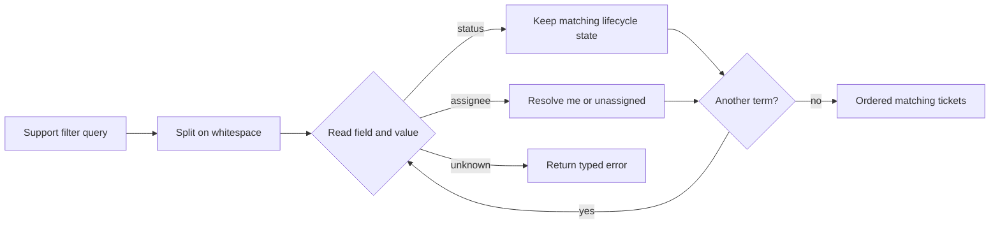

# Interpreter Problem: Support Inbox Filters

Problem-definition date: 2026-10-23

Internal Day 081 defines a deliberately small filter language for a customer
support inbox. Agents can narrow a stable ticket list with queries such as
`status:open assignee:me`, without opening an advanced-search screen or making
the UI understand how ticket fields are evaluated.

Two fields and four useful values do not justify an expression hierarchy. A
single loop splits space-delimited terms, switches on the field, validates its
bounded vocabulary, and applies each predicate in sequence. Interpreter remains
a hypothesis until richer composition makes that direct branch difficult to
extend or diagnose safely.

## Product scenario

A support agent starts a shift with tickets ordered by the inbox service. The
agent needs to isolate open conversations assigned to them, inspect everything
still unassigned, or view tickets in one lifecycle state. Filter chips and saved
views produce the same compact query string, so its meaning must be independent
of which UI created it.

This teaching unit covers an in-memory ticket collection, two case-sensitive
fields, whitespace-separated terms, AND semantics, stable result order, a
current-agent alias, an unassigned alias, and typed failures. Free text, quoted
values, parentheses, OR, NOT, precedence, ranges, dates, sorting, pagination,
remote query translation, localization, and user-defined fields are outside
today's grammar.

## Bounded grammar

```text
query          = term *(whitespace term)
term           = status-term / assignee-term
status-term    = "status:" ("open" / "waiting" / "closed")
assignee-term  = "assignee:" ("me" / "unassigned")
```

An empty query is valid and returns the original inbox. Multiple terms are
conjunctive regardless of order. Repeating a field is allowed by the direct
implementation; contradictory values simply produce no matches.

## Requirements and invariants

| Requirement | Observable behavior |
| --- | --- |
| Status filter | `status:open`, `status:waiting`, and `status:closed` match only that lifecycle state. |
| Current agent | `assignee:me` resolves through the filter's supplied agent identifier. |
| Unassigned | `assignee:unassigned` matches a missing assignee, not a magic stored identifier. |
| Composition | Every additional term narrows the previous result with AND semantics. |
| Stable order | Matching tickets retain the inbox service's input order. |
| Blank query | Whitespace-only input returns the unfiltered ticket list. |
| Bounded failure | Malformed terms, empty values, unknown fields, and unsupported values return distinct typed errors. |

The direct filter also preserves these constraints:

1. A support ticket has a nonempty stable identifier.
2. The caller supplies a nonempty current-agent identifier; no global session is
   read during evaluation.
3. Query evaluation never mutates the tickets or their input collection.
4. Keywords and values are case-sensitive so normalization policy is not hidden
   inside the grammar.
5. The filter does not accept arbitrary assignee identifiers; today's product
   need is limited to the current agent and the unassigned queue.
6. Validation and filtering are synchronous because every required value is
   already in memory.

## Direct Swift first

[`SupportTicketFilterDirect.swift`](../Sources/DesignPatterns/Interpreter/SupportTicketFilterDirect.swift)
defines the value-semantic `SupportTicket`, its three lifecycle states, typed
query errors, and `DirectSupportTicketFilter`. The filter walks each term once.
Its field `switch` either narrows the working collection or rejects input that
falls outside the documented vocabulary.

Sequential calls to `filter` make AND semantics explicit and preserve source
order automatically. Supplying `currentAgentID` through the initializer keeps
`assignee:me` deterministic and testable without a singleton session or service
locator.

There is no token type, lexer, AST, expression protocol, terminal or
nonterminal class, recursive evaluator, parser combinator, visitor, generic
predicate registry, repository, or async pipeline. For two independent fields,
those structures would add a second representation of a grammar that currently
fits in one local `switch`.

## Acceptance tests

[`InterpreterProblemTests.swift`](../Tests/DesignPatternsTests/InterpreterProblemTests.swift)
uses Swift Testing to verify:

- status and current-agent terms compose with AND semantics;
- the unassigned alias remains distinct from stored agent identifiers;
- a single status term preserves inbox order;
- a blank query returns the unfiltered list; and
- malformed terms, missing values, unsupported fields, and unsupported values
  fail with distinct domain errors.

Run the focused suite with:

```sh
swift test -Xswiftc -warnings-as-errors --filter InterpreterProblemTests
```

## Initial evaluation flow



Observe the deliberately flat evaluation: each term narrows one collection and
then returns to the same field decision. An accessible equivalent is: the
query is split into terms; each status or assignee term filters the remaining
tickets; an unknown term stops with a typed error; after the final term, the
remaining tickets are returned in their original order.

## Evidence to gather on Day 082

The current grammar is safer as direct branching than as an Interpreter object
graph. Day 082 must introduce credible language pressure and set a firm boundary
before new parsing structure is accepted:

- Add a grouped alternative such as `status:(open|waiting)` and measure the
  parsing and evaluation branches it creates.
- Define whitespace, delimiter, and parenthesis failures with source positions
  useful enough for an inline editor message.
- Preserve the existing AND semantics while making any new OR scope explicit.
- Decide whether repeated fields remain valid, contradictory, or diagnostic.
- Compare a minimal internal representation with predicates, `NSPredicate`, a
  parser library, and server-side query parameters.
- State when nesting, escaping, precedence, or grammar growth should move the
  example to a maintained parser library instead of extending hand-written
  code.
- Reject Interpreter if one additional field or a flat set-membership value is
  the only new requirement.

The evidence must separate a useful domain language from ordinary filtering.
Giving two string branches names such as `Expression` and `Context` would not
reduce complexity.

## Initial editorial thesis

**Thesis:** A tiny support language should earn structure from grammar pressure,
not from two colons and a famous pattern name.

**Scene:** A matte-black support-ticket rail crosses the central and lower
frame from left to right. A compact warm-red selector gate reads two physical
keys—one lifecycle key and one ownership key—and lets only matching dark ticket
cards continue in their original order. Rejected malformed keys fall into one
small diagnostic tray. Use no screens, labels, people, chat bubbles, browser
icons, floating dashboards, code, or decorative circuits.

The final Day 083 header should retain this small-language selector metaphor
only if Day 082 proves that grammar composition benefits from explicit
interpretation. It must follow [`visual-style.md`](visual-style.md); no header
asset is generated during problem definition.

## Day 081 decision

The support-filter language is concrete, executable, and deliberately bounded,
but Interpreter has not earned any participants. One loop, one field `switch`,
and typed errors keep the accepted vocabulary visible while avoiding a token
model and recursive expression graph that today's flat grammar cannot justify.
