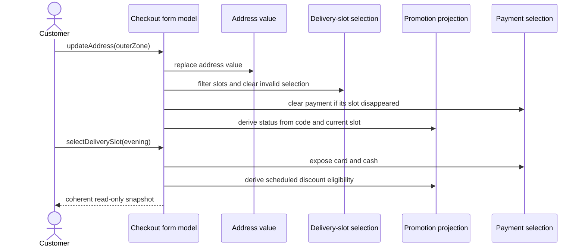

# Mediator Problem: Delivery Checkout Coordination

Problem-definition date: 2026-10-11

Internal Day 067 defines a direct coordination baseline for a delivery checkout.
Address, delivery-slot, promotion, and payment sections show separate concerns
in the UI, but their values are not independent: changing an address can remove
a selected slot, and changing a slot can invalidate both a payment method and a
promotion.

One checkout form model currently owns the four small, fixed sections. Explicit
mutation methods keep the cross-field rules visible in one place, so introducing
participant protocols or a Mediator object would only split a clear value model
before any independently owned module has demonstrated that need.

## Product scenario

A customer chooses delivery for a restaurant order. Express delivery serves the
central zone and requires card payment. Scheduled windows serve a wider area,
accept card or cash, and can qualify for a scheduled-delivery promotion. The
form must never retain a slot, payment method, or promotion result that no longer
matches the current address and delivery choice.

This teaching unit covers an in-memory form, two delivery zones, configured
slots and promotions, deterministic eligibility, and an order-readiness
projection. Address search, geocoding, remote slot refresh, inventory, pricing,
payment authorization, UI rendering, persistence, and concurrent server updates
are outside today's scope.

## Requirements and invariants

| Requirement | Observable behavior |
| --- | --- |
| Address changes | Only slots serving the new delivery zone remain available. |
| Stale slot | A selected slot is cleared when the new address cannot use it. |
| Payment availability | The selected slot determines which payment methods are offered. |
| Stale payment | A payment selection is cleared when a new slot does not accept it. |
| Promotion eligibility | An entered code is reevaluated whenever the selected slot changes. |
| Order readiness | Address, slot, and payment must form one coherent selection. |

The direct form also preserves these constraints:

1. Slot identifiers and promotion codes are unique within one form.
2. Every slot serves at least one zone and accepts at least one payment method.
3. A promotion applies to an explicit nonempty set of slot identifiers.
4. Slot and payment order remains stable for predictable UI presentation.
5. Failed slot or payment selection returns `false` without changing the form.
6. An invalid promotion remains observable but does not corrupt core checkout
   selections.

## Direct Swift first

[`DeliveryCheckoutDirect.swift`](../Sources/DesignPatterns/Mediator/DeliveryCheckoutDirect.swift)
uses plain value types for the four section inputs and one
`DirectDeliveryCheckoutForm` for their interaction rules. The UI sends product
intent through `updateAddress(_:)`, `selectDeliverySlot(id:)`,
`applyPromotionCode(_:)`, and `selectPaymentMethod(_:)`.

The form computes `DeliveryCheckoutFormSnapshot` as a read-only projection.
Address updates filter slots and discard an incompatible selection. Slot updates
recompute payment availability and discard an invalid payment. Promotion status
is derived from the current code and slot, so no callback needs to push a result
back into another section.

There is no mediator protocol, colleague protocol, delegate graph, event bus,
notification center, coordinator layer, repository, or reference-semantic child
module. A single form model already expresses the complete interaction with less
indirection and no feedback-loop guard.

## Acceptance tests

[`MediatorProblemTests.swift`](../Tests/DesignPatternsTests/MediatorProblemTests.swift)
uses Swift Testing to verify:

- the address exposes only slots that serve its zone;
- an address change clears a now-invalid slot and payment selection;
- unavailable slot and payment choices fail without mutating the form;
- promotion status follows the current delivery slot;
- a card-only slot clears a previous cash selection; and
- order placement becomes available only after address, slot, and payment agree.

Each test creates an independent form value, so the suite remains safe under
Swift Testing's default parallel execution. Run the focused suite with:

```sh
swift test -Xswiftc -warnings-as-errors --filter MediatorProblemTests
```

## Initial interaction flow



Observe the current ownership boundary: every customer action enters one form
model, which updates or derives the affected section values without sections
calling one another. An accessible equivalent is: an address change first
filters delivery slots, which can clear payment and alter promotion status; a
later slot choice recalculates payment availability and promotion eligibility;
the customer observes one consistent snapshot after each action.

## Evidence to gather on Day 068

The interaction is real, but Mediator has not earned a separate object while one
form model and four fixed values remain easy to follow. Day 068 will introduce
credible independent ownership and measure the cost of direct coordination:

- Separate address, delivery, promotion, and payment modules around their own
  state and lifecycle.
- Make direct dependencies explicit rather than hiding them in test setup.
- Count bidirectional references or callbacks needed to keep selections fresh.
- Demonstrate a realistic feedback-loop risk when one module reacts to another
  module's corrective update.
- Identify which interaction policy could move to a mediator and which domain
  validation must remain inside each participant.
- Reject a mediator that merely forwards every event or absorbs pricing,
  networking, navigation, and unrelated business logic.

The goal is not to decentralize a working view model for architectural theatre.
Only independently owned participants and verified coordination risk can justify
a new interaction boundary.

## Initial editorial thesis

**Thesis:** Checkout sections should react to one another without tying the form
into a knot of callbacks.

**Scene:** A matte-black checkout rail crosses the lower frame from left to
right. Four distinct machined modules represent address, delivery window,
promotion, and payment. Short warm-red links currently pass through one compact
central routing plate, while faint alternative direct links between modules
suggest the knot that later growth could create. One invalid outer-zone route is
visibly diverted before it reaches a card-only express module. The scene uses no
screens, labels, people, shopping carts, floating dashboards, or decorative
circuits.

The final Day 069 header should keep this controlled routing-plate metaphor only
if measured module coupling justifies a focused mediator. It must follow
[`visual-style.md`](visual-style.md); no header asset is generated during problem
definition.

## Day 067 decision

The checkout interactions are executable and tested, but a dedicated Mediator
is premature. One value-semantic form, focused mutation methods, and one
derived snapshot keep dependencies coherent without child references or event
cycles. Mediator remains a hypothesis until independently owned modules make
that direct coordination meaningfully harder to change or verify.
