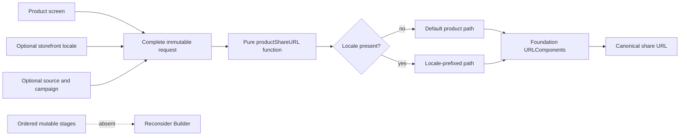

# 🧭 No Pattern: Keep the Complete Product-Share Request

<a id="no-pattern-keep-the-complete-product-share-request"></a>

Decision date: 2026-11-01


*One complete request takes the short route; construction machinery stays out until the product actually needs a construction lifecycle.*

This guide closes the three-day product-share case from Internal Days 088–090. The result is deliberately not a twenty-fourth pattern. A typed immutable request, one pure function, and Foundation's `URLComponents` remain the safer design after a realistic localization requirement.

The important outcome is not that Builder is bad. It is that the app still has no observable construction behavior for Builder to own.

[← Repository overview](../README.md) · [Pattern catalogue](../README.md#pattern-catalogue) · [Reading guide](../README.md#reading-guide)

**On this page**

- [App problem](#app-problem)
- [Direct Swift solution](#direct-swift-solution)
- [The realistic change](#the-realistic-change)
- [Why Builder does not earn its cost](#why-builder-does-not-earn-its-cost)
- [Decision](#decision)
- [Concrete signal to revisit the decision](#concrete-signal-to-revisit-the-decision)
- [Implementation flow](#implementation-flow)
- [Tests and execution](#tests-and-execution)
- [Trade-offs retained by the direct design](#trade-offs-retained-by-the-direct-design)
- [Alternatives](#alternatives)
- [When not to introduce a pattern](#when-not-to-introduce-a-pattern)
- [Related evidence and files](#related-evidence-and-files)

## App problem

A commerce app creates canonical product links for its share sheet. Every link contains a product identifier and may also contain:

- one supported storefront locale;
- the app surface where sharing started; and
- a campaign identifier.

The locale changes the destination path. Attribution changes the query. All inputs are known before URL creation starts, and each call must remain independent from every previous call.

The initial review suggestion was a fluent `ProductShareLinkBuilder` with methods such as `setDestinationLocale`, `setSource`, `setCampaignID`, and `build()`. That API is familiar, but familiarity does not show that mutable construction state reduces risk.

## Direct Swift solution

[`ProductShareURL.swift`](../Sources/DesignPatterns/NoPattern/ProductShareURL.swift) uses the smallest vocabulary that makes invalid product inputs harder to express:

- `ProductShareSurface` closes the attribution-source vocabulary;
- `ProductShareLocale` closes the supported storefront vocabulary;
- `ProductShareRequest` holds the complete input as an immutable value; and
- `productShareURL(for:)` translates that value into one `URL`.

```swift
let request = ProductShareRequest(
    productID: productID,
    destinationLocale: .portugueseBrazil,
    source: .favorites,
    campaignID: campaignID
)

let url = try productShareURL(for: request)
```

The function creates a fresh `URLComponents`, chooses the default or localized path, appends attribution in stable order, and returns the final URL. Foundation owns percent encoding and URL assembly. No app type retains intermediate state.

## The realistic change

The baseline first supported one canonical `/products/<id>` path. Internal Day 089 added three explicit storefront locales whose paths look like:

```text
https://shop.example.com/pt-br/products/<product-id>
```

That requirement added one enum, one defaulted request property, and one path decision. It did not add:

- values arriving at different times;
- a required order between configuration steps;
- an invalid intermediate transition;
- a reusable partially configured object;
- more than one output representation; or
- URL mechanics not already owned by `URLComponents`.

The change therefore expanded the domain vocabulary without creating a construction lifecycle.

## Why Builder does not earn its cost

The minimum credible Builder would retain the same product identifier, locale, source, and campaign values while adding mutable storage, setter operations, and `build()`.

| Decision evidence | Complete request plus function | Minimum concrete Builder |
| --- | --- | --- |
| Valid input | One finished value | A mutable value that may be unfinished or ready |
| Step order | None | Exposed even though the product assigns it no meaning |
| Reuse | Fresh request per share | Needs reset rules or a fresh builder anyway |
| URL mechanics | `URLComponents` | Still `URLComponents`, now hidden behind `build()` |
| Localization change | Enum, property, path branch | The same changes plus builder storage, setter, and reset semantics |
| Cross-call leakage | Impossible through immutable values | Possible if a builder is reused incorrectly |
| Tests that matter | Product combinations and invariants | The same tests plus invented setter-lifecycle tests |

The Builder would not remove any current branch or validation rule. It would only move existing values into a longer-lived mutable container and create questions about readiness and reuse that the feature does not otherwise have.

## Decision

Keep the direct solution.

This is an explicit architectural decision, not a deferred refactor. The current requirements are represented completely by one immutable request and one stateless transformation. A named construction pattern would increase the number of states and operations without reducing coupling, duplication, or change risk.

The design remains intentionally narrow:

1. Screens provide domain values, not query-item names or path fragments.
2. `ProductShareRequest` is complete immediately after initialization.
3. `productShareURL(for:)` is the only translation boundary.
4. `URLComponents` remains the only assembly mechanism.
5. Every call starts with fresh local state.

## Concrete signal to revisit the decision

Revisit Builder when a product requirement makes **construction itself observable**—specifically, when input must arrive from separate stages in an enforced order and invalid intermediate transitions must be rejected before a final share artifact can exist.

For example, Builder would become credible if a campaign workflow had to:

1. select and validate a destination before attribution was allowed;
2. attach asynchronously approved campaign data in a later stage;
3. reject `build()` until required approvals and disclosures were present; and
4. reuse that ordered recipe to produce both a share URL and a reviewable share preview or campaign manifest.

The first three points create a real lifecycle. The fourth can make a shared recipe more valuable. A longer initializer, another optional field, or a desire for fluent syntax is not the signal.

Use this review rule:

| New pressure | Response |
| --- | --- |
| Another value is known up front and can be typed | Extend the immutable request. |
| One value needs semantic validation | Validate in the request initializer or a focused value type. |
| Callers need different URL policies | Inject a function or small strategy only after variation exists. |
| Values arrive across required, validated stages | Reconsider Builder. |
| One ordered recipe must emit multiple representations | Reconsider Builder or a focused construction pipeline. |

## Implementation flow



Observe that every current input joins a complete request before URL creation. The dashed branch is not part of the implementation: it records the missing ordered-stage pressure that would trigger a future review.

An accessible equivalent is: the screen, optional locale, and optional attribution create one immutable request; a pure function chooses a path and passes it to `URLComponents`; the final result is one canonical URL. Builder is reconsidered only if ordered mutable stages become a real requirement.

## Tests and execution

[`NoPatternProblemTests.swift`](../Tests/DesignPatternsTests/NoPatternProblemTests.swift) verifies the behavior that matters:

- canonical organic links;
- every supported share surface;
- stable source-before-campaign ordering;
- every supported storefront locale;
- path and attribution independence; and
- absence of state leakage between calls.

Run the focused executable evidence from the repository root:

```sh
swift test -Xswiftc -warnings-as-errors --filter NoPatternProblemTests
```

The tests cover product-value combinations rather than setter permutations. Testing setter order would legitimize a lifecycle that the product does not have.

## Trade-offs retained by the direct design

The direct solution is not free of change cost:

- adding a supported locale changes the enum and path selection;
- adding attribution changes the request and query construction;
- the function knows the one canonical URL representation; and
- callers must construct a complete request before asking for a URL.

Those costs align with the current domain. They are visible, localized, and covered by tests. Splitting them across a Builder would distribute the same knowledge while adding mutable lifetime.

## Alternatives

### Throwing initializer

Use a throwing request initializer when domain inputs can be individually typed but their combination can still be invalid. Current inputs have no such cross-field failure, so throwing during request creation would add ceremony without rejecting a real state.

### Focused value type

Use a small value type when a new field has its own parsing or validation rules. `ProductShareLocale` already demonstrates this direction with a closed enum. The presence of several value types does not imply Builder.

### Configuration closure

A trailing closure over mutable options or `URLComponents` would make mutation look compact while leaking path and query mechanics back to callers. It does not improve this boundary.

### Strategy

Strategy becomes relevant if several real URL policies must vary independently at runtime. One localized path switch is closed domain data, not an interchangeable algorithm family.

### Factory Method

Factory Method is useful when subclasses or conforming providers must select and create different products inside a stable workflow. This case creates one known `URL` and has no provider-specific creation hook.

## When not to introduce a pattern

Keep ordinary Swift when the behavior can still be described as a complete value transformed by a focused function, enum, initializer, collection operation, actor, or platform API.

Do not introduce a named pattern merely because:

- an initializer spans several lines;
- inputs are optional;
- a platform type is configured step by step internally;
- fluent syntax looks more expressive in a code review;
- a pattern could model hypothetical future requirements; or
- the example needs to fill a catalogue slot.

A pattern should move demonstrated responsibility to a better owner. If it only renames existing steps and adds lifetime, keep the direct solution.

## Related evidence and files

- [Initial problem and acceptance criteria](no-pattern-problem.md)
- [Localization pressure and Builder comparison](no-pattern-evidence.md)
- [Production implementation](../Sources/DesignPatterns/NoPattern/ProductShareURL.swift)
- [Executable acceptance tests](../Tests/DesignPatternsTests/NoPatternProblemTests.swift)
- [Editorial header](Assets/Patterns/pragmatic/no-pattern-header.png)
- [Catalogue visual contract](visual-style.md)
