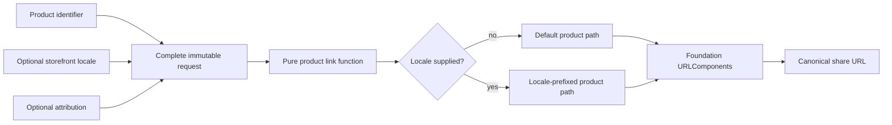

# No-Pattern Evidence: One More Value, Still One Complete Request

Evidence-review date: 2026-10-31

Internal Day 089 tests the Builder proposal from the
[no-pattern problem](no-pattern-problem.md) against a realistic change. Product
links may now target one of three supported storefront locales. The locale is
optional, known before link construction starts, and changes the destination
path without changing attribution.

The result is evidence for the direct design, not yet the final Day 090
verdict. No Builder implementation is retained in production merely to make a
comparison look symmetrical.

## The requirement that changed

A shopper may share the default canonical product URL or explicitly target the
United States English, Brazilian Portuguese, or Mexican Spanish storefront.
Localized links place the locale before the product path:

```text
https://shop.example.com/pt-br/products/<product-id>
```

The locale comes from product configuration at the same time as the product
identifier and optional attribution. It is not discovered by a later screen,
does not require network work, and does not alter the source or campaign query.
Unknown locale strings remain unrepresentable at this boundary.

## Direct Swift extension

[`ProductShareURL.swift`](../Sources/DesignPatterns/NoPattern/ProductShareURL.swift)
adds one closed `ProductShareLocale` enum and one defaulted property to
`ProductShareRequest`. The existing initializer still receives the complete
request. The existing free function chooses either the default product path or
the locale-prefixed path, then leaves URL encoding and assembly to
`URLComponents`.

```swift
let request = ProductShareRequest(
    productID: productID,
    destinationLocale: .portugueseBrazil,
    source: .favorites,
    campaignID: campaignID
)

let url = try productShareURL(for: request)
```

This change adds domain vocabulary, not a construction lifecycle. Every valid
combination is still supplied atomically, and an omitted locale preserves the
original canonical URL.

## Minimum credible Builder comparison

For the same behavior, the smallest custom Builder would need storage for the
required product identifier and three optional values, one operation for each
optional value, and `build()`:

```swift
var builder = ProductShareLinkBuilder(productID: productID)
builder.setDestinationLocale(.portugueseBrazil)
builder.setSource(.favorites)
builder.setCampaignID(campaignID)
let url = try builder.build()
```

A protocol, director, staged generic graph, or separate concrete builders would
make the comparison less credible because current requirements justify none of
them. Even this minimal concrete type introduces mutable lifetime and the
question of whether it may be reused.

| Evidence | Immutable request plus function | Minimum concrete Builder |
| --- | --- | --- |
| Production construction types | Request, closed enums, platform value | The same domain types plus a mutable builder |
| Optional-value combinations | Eight complete request values | Eight builder storage combinations that may be intermediate or ready |
| Localized call | One initializer, then the existing function | Initialize, mutate locale, then build |
| Step order | None; all inputs exist before construction | Setter order is accepted but has no product meaning |
| Reuse | Fresh value per share | Requires reset rules or a fresh builder anyway |
| URL mechanics | Owned by `URLComponents` | Still owned by `URLComponents` inside `build()` |
| Adding locale | Enum, request property, path branch | The same work plus builder storage, setter, and reset behavior |

The eight combinations are not themselves a problem: locale, source, and
campaign are three independent optional product values. In the direct API each
combination is a finished request. In a Builder, the same storage state cannot
say whether the caller is still configuring it or simply omitted the remaining
values. `build()` supplies a lifecycle marker for a lifecycle the product does
not have.

## Executable evidence

[`NoPatternProblemTests.swift`](../Tests/DesignPatternsTests/NoPatternProblemTests.swift)
now verifies every supported locale with parameterized cases. Each case proves
that the locale occupies the path prefix and does not invent a query. The
existing organic and attribution cases remain unchanged, while the independence
test now performs a fully localized, attributed call before an organic call and
confirms that neither path nor query state leaks.

Run the focused suite from the repository root:

```sh
swift test -Xswiftc -warnings-as-errors --filter NoPatternProblemTests
```

These tests exercise value combinations, not setter permutations. Setter order
has no observable requirement, so testing all six orders for three operations
would validate an invented Builder API rather than product behavior.

## Smaller alternatives considered

### Throwing request initializer

The new locale is a closed enum and the other inputs are already typed. There
is no semantic failure for the initializer to report. Moving `URLComponents`
into a throwing initializer would couple the request value to one output
representation without removing risk.

### Configuration closure

A closure that exposes mutable options or `URLComponents` would hide mutation
inside trailing-closure syntax. It would also let call sites depend on query
names, ordering, or platform mechanics that the current function centralizes.

### Arbitrary locale string

A `String?` avoids the enum declaration but admits unsupported routing values
and moves validation to runtime. The enum is justified domain vocabulary; it
is not evidence for a construction pattern.

### Builder with reset

Reusing a Builder could save one allocation while creating cross-call leakage
risk for locale, source, and campaign. There is no measured hot path and no
requirement to preserve configuration between products, so a reset operation
would solve only state introduced by the Builder itself.

## Pressure that is still absent

The localized requirement does not add ordered steps, intermediate validation,
partial data arriving from different product stages, multiple output
representations, or a reusable construction recipe. The product still has one
complete input value and one `URL` result.

Builder becomes worth revisiting only when construction itself acquires
observable behavior—for example, separate product stages must contribute data
in a required order, invalid intermediate transitions must be rejected, and
the same ordered recipe must produce more than one representation. More fields,
fluent syntax, or a longer initializer are not that signal.

## Evidence diagram



Observe that locale joins the other values before construction and only selects
a path. An accessible equivalent is: product identifier, optional locale, and
optional attribution form one immutable request; a pure function chooses the
default or localized path; `URLComponents` produces the canonical URL.

## Day 089 decision

The first realistic extension does not create Builder pressure. A closed enum,
one defaulted initializer value, and one path decision preserve every existing
invariant while keeping the request complete and calls independent. Day 090
should keep the direct solution and turn the absent-pressure threshold into the
final documented no-pattern verdict.
