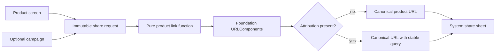

# No-Pattern Problem: Product Share Links

Problem-definition date: 2026-10-30

Internal Day 088 examines a plausible request to “clean up” product-share URL
construction with Builder. A commerce app needs canonical links for products
and can attach two pieces of attribution when a campaign or app surface
provides them. Optional inputs and a step-by-step platform type make Builder
look familiar, but familiarity is not evidence that the pattern lowers risk.

The direct Swift baseline is one immutable request, one pure function, and
Foundation's `URLComponents`. It has no partial construction state, ordering
protocol, reusable mutable builder, or family of representations. Builder
remains only a proposal until measured change pressure shows that those missing
participants would solve a real problem.

## Product scenario

A shopper can share a product from its detail screen, favorites, or order
history. The receiving browser must always open one canonical HTTPS product
URL. Marketing attribution is optional: organic shares carry no query, while
known app surfaces and campaigns add stable query items for downstream
analytics.

This teaching unit covers a fixed host, one UUID product identifier, three app
surfaces, one optional campaign identifier, stable query ordering, and
independent calls. Custom hosts, universal-link routing, short-link services,
asynchronous network calls, authenticated links, arbitrary query dictionaries,
campaign validation, analytics delivery, and share-sheet presentation are
outside today's boundary.

## The proposed refactor

The code-review suggestion is to add `ProductShareLinkBuilder`, chain methods
such as `withSource` and `withCampaign`, and finish with `build()`. That API can
look expressive in isolation, especially beside `URLComponents`, which itself
is configured incrementally.

The product behavior does not currently share the same construction pressure:

- there is one output representation, `URL`;
- one field is required and two fields are optional;
- every valid combination can be passed atomically;
- no construction steps must occur in a particular order;
- no intermediate state is reused across products; and
- Foundation already owns percent encoding and URL assembly.

Adding a named Builder today would duplicate an existing platform abstraction
and introduce mutable lifetime questions the product does not have.

## Requirements and invariants

| Requirement | Observable behavior |
| --- | --- |
| Canonical destination | Every link uses HTTPS, `shop.example.com`, and the lowercased product UUID under `/products/`. |
| Organic default | A request with no attribution produces no query string. |
| Known source | Product details, favorites, and order history map to explicit stable values. |
| Optional campaign | A campaign UUID is emitted only when supplied. |
| Stable ordering | Source precedes campaign when both are present. |
| Independent calls | Options supplied to one request cannot leak into the next link. |
| Platform encoding | `URLComponents` remains responsible for producing the final `URL`. |

The baseline also preserves these constraints:

1. `UUID` makes an empty or separator-bearing product identifier
   unrepresentable.
2. `ProductShareSurface` closes the current source vocabulary instead of
   accepting analytics strings at every call site.
3. The request uses value semantics and exposes no mutating configuration
   steps.
4. The free function has no retained state, cache, dependency, or concurrency
   boundary.
5. Query names and ordering live in one implementation rather than in feature
   screens.
6. URL creation returns a typed failure instead of force-unwrapping a platform
   optional, even though the current typed inputs make failure defensive.

## Direct Swift first

[`ProductShareURL.swift`](../Sources/DesignPatterns/NoPattern/ProductShareURL.swift)
defines `ProductShareSurface`, the immutable `ProductShareRequest`, one narrow
error, and `productShareURL(for:)`. The function configures `URLComponents`
locally, appends only supplied attribution, and immediately returns the URL.

The request initializer is the whole configuration surface. Defaulted optional
arguments keep organic sharing concise without creating an object that can be
half configured. A fresh local `URLComponents` value on every call makes state
leakage impossible by construction.

There is no builder protocol, concrete builder, director, chained mutation,
reset operation, result generic, factory, repository, service, or dependency
container. The direct code retains the domain vocabulary while leaving URL
mechanics to Foundation.

## Acceptance tests

[`NoPatternProblemTests.swift`](../Tests/DesignPatternsTests/NoPatternProblemTests.swift)
uses Swift Testing to verify:

- an organic request produces the canonical HTTPS product URL without a query;
- every supported app surface maps to its stable source value;
- source and campaign appear in a deterministic order; and
- an attributed call cannot contaminate a later organic call.

The surface mapping is parameterized so each case has independent diagnostics.
All fixtures are immutable, generated in-process, and safe under parallel test
execution. Run the focused suite with:

```sh
swift test -Xswiftc -warnings-as-errors --filter NoPatternProblemTests
```

## Initial construction flow



Observe that every input arrives before construction starts and the platform
type performs the only assembly. An accessible equivalent is: a product screen
and optional campaign create one immutable request; a pure function passes its
typed values to `URLComponents`; the result has either no query or a stable
attribution query before it reaches the system share sheet.

## Evidence to gather on Day 089

The direct function is currently smaller and safer than a custom Builder. Day
089 must make that comparison concrete rather than relying on line count alone:

- model the minimum credible Builder API for exactly the same behavior;
- compare its types, mutable states, call-site steps, and reset semantics with
  the immutable request and free function;
- prove whether step ordering or reusable construction actually exists in
  product requirements;
- examine how both designs handle adding one optional destination locale;
- distinguish semantic validation from mechanical URL assembly already owned
  by `URLComponents`;
- compare Builder with a throwing initializer and a small configuration closure
  only if either removes a demonstrated problem; and
- identify the first concrete signal that would make Builder worth revisiting.

The comparison must reject aesthetic arguments such as fluent syntax or a
shorter call-site line. The question is whether additional lifetime and state
reduce change risk across real callers.

## Initial editorial thesis

**Thesis:** Three typed inputs and one platform value need a complete request,
not a construction hierarchy.

**Scene:** A matte-black product token enters one compact warm-red routing jig.
Two optional attribution tabs can click into fixed slots before the token passes
through a single Foundation-owned URL channel. Beside it, an oversized unused
multi-stage assembly rig remains visibly bypassed. Use no screens, people,
shopping carts, chain-link icons, floating dashboards, code, generic factory
machinery, or decorative circuits.

The final Day 090 header should retain this bypassed-assembly metaphor only if
Day 089 confirms that the direct design remains safer under the next realistic
change. It must follow [`visual-style.md`](visual-style.md); no header asset is
generated during problem definition.

## Day 088 decision

The Builder proposal is plausible but unearned. One immutable request plus a
pure function and `URLComponents` expresses every current valid combination,
keeps calls independent, and avoids inventing mutable construction state. The
named pattern remains a hypothesis for Day 089, not an implementation goal.

Day 089 tests that hypothesis with an optional storefront locale in the
[no-pattern evidence review](no-pattern-evidence.md).
