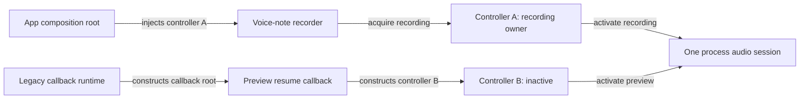

# Singleton Pressure: One Resource, Two Construction Roots

Pressure-review date: 2026-10-28

Internal Day 086 implements the direct solution from the
[Singleton problem](singleton-problem.md), then exercises the construction
boundary that dependency injection alone cannot enforce. The app composition
root owns the controller used by recording and preview features, but a legacy
preview-resume callback is instantiated by its runtime from a type name and a
zero-argument initializer. That runtime cannot receive the app root's object.

The controller remains an injected dependency everywhere the app controls
construction. Today's work does not add `shared`, a service locator, static
mutable storage, a reset hook, or the final Singleton implementation.

## The requirement that changed

Preview playback must resume from a callback created outside the app's
dependency graph. The legacy runtime accepts a callback type, constructs it
itself, and invokes it later; it does not accept a closure, context pointer,
factory value, environment, or already-built handler.

This is the narrow pressure. A regular recorder, SwiftUI view, view model, or
notification observer can receive the controller and does not justify shared
access. If the callback API later gains registration with captured context, the
app should inject the controller there and remove the shared entry point.

## Direct implementation under pressure

[`AudioSessionController`](../Sources/DesignPatterns/Singleton/AudioSessionController.swift)
is still the complete production implementation. Its actor-isolated state
machine reserves one owner before suspending at the platform boundary and
recovers coherently from activation and deactivation failures.

The direct approach works when every feature receives the same controller
reference. The new executable evidence in
[`SingletonProblemTests`](../Tests/DesignPatternsTests/SingletonProblemTests.swift)
models the two construction outcomes:

1. The app root and callback root use the same injected controller. Recording
   acquires it, preview receives `occupied`, and the platform sees one
   activation.
2. Each root constructs its own controller over the same platform session.
   Both actors begin in `inactive`, both accept ownership, and the platform
   sees recording followed by preview activation.

The second outcome is not a race or an actor-reentrancy bug. Each actor protects
its own correct state. The violated invariant is object identity: two locally
valid controllers claim authority over one process-wide resource.

## Observable pressure

The evidence now exposes three concrete costs rather than forecasting them:

| Observation | Same injected instance | Independent instances |
| --- | --- | --- |
| Controller state | One ownership state machine | Two internally consistent state machines |
| Competing preview | Rejected with both owner IDs | Accepted as a second owner |
| Platform calls | One recording activation | Recording and preview activations |
| Test isolation | Fresh controller and spy per test | Still fresh, but unable to enforce process identity |

An `actor` serializes access to one instance; it does not make that instance
unique. Dependency injection makes dependencies explicit; it does not connect
construction roots that the app cannot control. Requiring developers to
remember "construct exactly one" is a convention, not an enforced invariant.

## Alternatives at this boundary

### Register an injected callback

Prefer this whenever the runtime accepts a closure, context pointer, handler
instance, or factory. The registration can capture the injected controller and
needs no Singleton. The stated legacy runtime offers none of those seams, so
this option is unavailable for the one callback under review.

### Use a SwiftUI environment value

An environment value is appropriate for dependencies flowing through a SwiftUI
view tree. The runtime-created callback is outside that tree, and moving audio
ownership into UI environment state would give presentation infrastructure
authority over a process resource.

### Isolate the code with a custom global actor

A global actor chooses a shared executor for declarations. It does not provide
one audio-session controller, prevent callers from constructing two state
machines, or define activation rollback. It would change scheduling vocabulary
without enforcing resource identity.

### Add a service locator

A process-wide dictionary could return the controller, but it would also make
arbitrary services globally discoverable, erase constructor dependencies, and
move type and lifetime failures to runtime. That machinery is broader than the
single resource constraint.

### Move the callback into another process

Another process owns another operating-system session and cannot coordinate the
current process's active recording. This changes the product behavior rather
than solving the ownership boundary.

## Pressure diagram



Observe that both arrows reach the same operating-system session through
different, internally valid ownership state machines. An accessible equivalent
is: the app root injects controller A into recording, the legacy runtime creates
a separate callback root that constructs controller B, and both controllers
activate the one process audio session because neither can observe the other's
owner.

## Test-isolation constraint for Day 087

The solution must not turn the process singleton into shared test state. Normal
recording and preview clients must continue accepting an injected controller,
and tests must be able to construct a fresh ownership boundary and platform spy
without mutating or resetting a global instance. Only the runtime-created
callback may cross through the controlled shared entry point.

That excludes a mutable `static var`, an `installForTests` API, teardown-based
reset logic, and a locator. Day 087 must keep the shared production identity
separate from the initializer used by isolated tests and injected clients.

Day 087 implemented that boundary with an immutable `shared` identity and a
package-only isolated factory. The [canonical guide](../Creational%20Patterns/Singleton/README.md)
documents the resulting API; this file retains the pressure that justified it.

## Verification

Run the focused evidence from the repository root:

```sh
swift test -Xswiftc -warnings-as-errors --filter SingletonProblemTests
```

The suite now verifies the original ownership and rollback behavior plus the
identity pressure: a shared injected reference admits one owner, while two
controllers issue two activations against the same platform boundary.

## Day 086 decision

Singleton has earned consideration only for the legacy callback's bridge to the
one process ownership state. The rest of the app keeps dependency injection.
Day 087 may add one controlled immutable shared identity, but it must not make
ordinary services globally accessible or require test resets.
