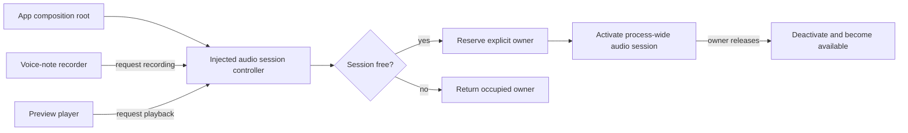

# Singleton Problem: One Process-Wide Audio Session

Problem-definition date: 2026-10-27

Internal Day 085 defines the resource that may eventually justify Singleton: a
recording app has one operating-system audio session for its entire process.
Voice-note recording and preview playback need different configurations, but
they cannot each behave as though they own an independent session.

One unique platform resource does not automatically justify global access. The
direct Swift baseline creates one controller at the composition root, injects
that same reference into feature modules, and makes ownership explicit. A
`static shared` entry point remains a hypothesis until a real caller cannot
receive the injected dependency.

## Product scenario

A journaling app records voice notes and plays short previews before a note is
saved. Recording needs the system session prepared for microphone input;
preview playback needs it prepared for output. Switching those purposes while
the other feature is active can interrupt capture, mute playback, or leave the
process-wide session in a configuration neither feature expects.

The teaching unit starts after microphone permission has been granted. Audio
capture, file storage, waveform rendering, route selection, Bluetooth policy,
mixing with other apps, background execution, and interruption notifications
are outside today's boundary. The behavior under review is ownership of the
single platform session while one feature activates or deactivates it.

## Requirements and invariants

| Requirement | Observable behavior |
| --- | --- |
| Explicit owner | Every activation identifies the feature that owns the session. |
| One active purpose | Recording and preview playback cannot configure the platform session simultaneously. |
| Serialized transition | A second request is rejected even while the first platform activation is suspended. |
| Owner-only release | A feature cannot deactivate a session reserved by another feature. |
| Activation rollback | A failed platform activation leaves the controller available for a later request. |
| Deactivation rollback | A failed platform deactivation preserves the current owner because the system resource may still be active. |
| Injectable boundary | Tests and clients receive a controller reference; no code reads global mutable state. |

The baseline also preserves these constraints:

1. The platform session is process-wide, but the controller is not constructed
   inside feature code.
2. A nonempty stable owner identifier makes conflicts diagnosable.
3. The actor owns transition state and serializes callers from unrelated tasks.
4. A transition reserves ownership before awaiting the platform boundary, so
   actor reentrancy cannot admit a competing feature.
5. The platform protocol exists only because the operating-system API is an
   external boundary and tests need a deterministic substitute.
6. UI state, recording state, and playback state remain outside the controller.

## Direct Swift first

[`AudioSessionControllerDirect.swift`](../Sources/DesignPatterns/Singleton/AudioSessionControllerDirect.swift)
defines two audio purposes, an explicit request value, the platform seam, and
`DirectAudioSessionController`. The controller is an actor because ownership is
mutable process coordination that can be requested from concurrent feature
tasks. It is not main-actor isolated because the resource is not UI state.

The composition root creates one controller with the real platform adapter and
passes that reference to recording and preview clients. The actor tracks only
four transition states: inactive, activating, active, and deactivating. It
reserves a request before the platform suspension point, rolls back a failed
activation to inactive, and rolls back a failed deactivation to the last active
owner.

This is deliberately not the Singleton pattern. There is no `shared` property,
private initializer, service locator, global actor, static mutable storage,
reset hook, or hidden lookup. The operating system supplies resource uniqueness;
ordinary dependency injection supplies application ownership and test seams.

## Acceptance tests

[`SingletonProblemTests.swift`](../Tests/DesignPatternsTests/SingletonProblemTests.swift)
uses Swift Testing with a fresh controller and platform spy per test to verify:

- activation configures one purpose and owner before release;
- a competing feature cannot reconfigure the active session;
- only the active owner can release it;
- simultaneous requests admit exactly one owner;
- failed activation releases the reservation; and
- failed deactivation preserves ownership.

The tests remain parallel-safe because they do not mutate a static singleton or
share a platform spy. Run the focused suite with:

```sh
swift test -Xswiftc -warnings-as-errors --filter SingletonProblemTests
```

## Initial ownership flow



Observe that uniqueness belongs to the platform resource, while object access
still flows from the composition root. An accessible equivalent is: the app
root injects one controller into recording and preview features; the controller
accepts one owner, activates the process-wide system session, rejects competing
requests, and deactivates only when that owner releases it.

## Evidence to gather on Day 086

Injection is currently sufficient. Day 086 must demonstrate a caller that the
composition root genuinely cannot supply, without turning convenience into a
uniqueness requirement:

- Model a platform callback or legacy entry point created outside the app's
  dependency graph.
- Show why constructing another controller would permit two application owners
  to compete over the same operating-system session.
- Preserve the injected controller for normal recording and preview clients.
- Prove that tests can replace the shared entry point without ordering or reset
  leaks.
- Compare a controlled shared instance with an app environment value, explicit
  callback registration, a custom global actor, and a service locator.
- Reject Singleton if the callback can accept a closure or injected reference
  with less lifetime machinery.

The next day must quantify the awkward boundary. A static property is not
evidence by itself, and avoiding one initializer argument is not a valid reason
to globalize an ordinary service.

## Initial editorial thesis

**Thesis:** One system resource needs one accountable owner, not invisible
access from everywhere.

**Scene:** A matte-black audio-routing chassis spans the central and lower frame.
Two dark input rails—one carrying a microphone capsule and one carrying a
playback waveform cartridge—converge on a single warm-red mechanical selector.
Only one rail can lock into the one central system-session chamber at a time;
the other meets a visible physical interlock. Use no screens, people, floating
UI, code, decorative circuits, duplicated session chambers, or generic cloud
symbols.

The final Day 087 header should retain this single-chamber ownership metaphor
only if Day 086 proves that one non-injectable entry point justifies controlled
shared access. It must follow [`visual-style.md`](visual-style.md); no header
asset is generated during problem definition.

## Day 085 decision

The audio session is genuinely unique, but Singleton has not earned global
access. One actor created at the composition root and injected into clients
keeps ownership serialized, failures recoverable, and tests isolated without
adding a shared instance.
