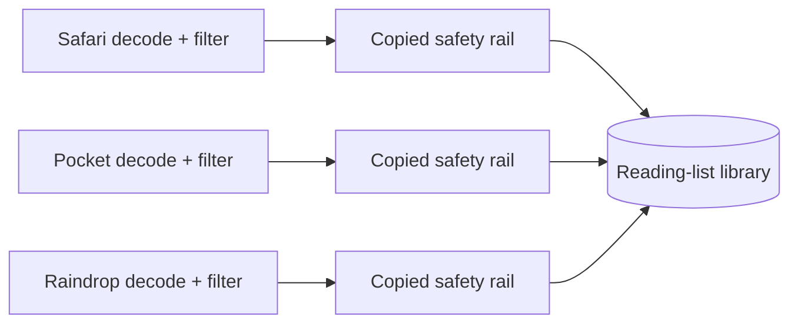

# Template Method Pressure: A Third Import Repeats the Safety Rails

Pressure-review date: 2026-10-15

Internal Day 072 adds a Raindrop export to the reading app from Day 071.
Raindrop's JSON shape and eligibility rule differ from Safari and Pocket, but
its accepted articles still need the same validation, normalization,
deduplication, atomic persistence, and reporting order.

The implementation remains direct on purpose. A third explicit import function
makes the synchronization risk observable before choosing whether a Template
Method deserves to own the invariant algorithm.

## The requirement that changed

Customers can now import a bounded projection of a Raindrop JSON export. The app
must:

- decode Raindrop's `title`, `link`, `type`, and `removed` fields;
- keep active articles while ignoring ordinary links and removed items;
- apply the same URL and title normalization used by Safari and Pocket;
- remove duplicates after provider filtering and normalization;
- append only when every eligible item is valid; and
- report Raindrop decoding failures as Raindrop failures.

Complete vendor schemas, collections, tags, highlights, pagination, file
selection, and export-version migration remain outside this example. They do
not change the question under study: who owns the stable import order?

## Direct implementation under pressure

[`ReadingListImportDirect.swift`](../Sources/DesignPatterns/TemplateMethod/ReadingListImportDirect.swift)
adds `importRaindropExport(_:into:)` beside the Safari and Pocket functions. It
uses one provider-specific `Decodable` projection and one eligibility filter,
then repeats the same orchestration:

1. validate nonempty input;
2. decode and translate provider failures;
3. select provider-owned candidates;
4. normalize every eligible candidate;
5. remove stored and batch duplicates;
6. append the complete valid batch; and
7. build a source-aware report.

The shared `normalize` and `entriesNotAlreadyStored` helpers remain ordinary
private functions. The pressure is not duplicated URL policy. It is that three
public workflows separately decide whether and when those safety rails run.

## Measured duplication

| Repeated responsibility | Day 071 | Day 072 |
| --- | ---: | ---: |
| Public provider import workflows | 2 | 3 |
| Payload validation calls | 2 | 3 |
| Provider-error translation blocks | 2 | 3 |
| Candidate normalization stages | 2 | 3 |
| Deduplication stages | 2 | 3 |
| Atomic append sites | 2 | 3 |
| Report construction sites | 2 | 3 |

Decoding and candidate selection are deliberately not counted as accidental
duplication. Their data shapes and eligibility rules genuinely vary. Validation
plus the four stages after selection do not vary, and validation must always
precede provider decoding.

Adding a provider now requires copying six invariant decisions around two real
variations. A missed normalization call could persist a noncanonical URL; an
early append could violate batch atomicity; an incorrect count could make the
import UI lie. The risk is behavioral drift, not the raw number of lines.

## Executable evidence

[`TemplateMethodPressureTests.swift`](../Tests/DesignPatternsTests/TemplateMethodPressureTests.swift)
uses one isolated value-semantic library per test and verifies that:

- Raindrop filters links and removed items before reporting eligible records;
- two canonical-equivalent articles become one stored entry and one duplicate;
- empty input fails as Raindrop before JSON decoding;
- malformed JSON cannot mutate persistence; and
- one invalid eligible URL rejects the complete batch, including a valid item
  that appeared before it.

These checks exercise the same safety rails already covered for Safari and
Pocket. They do not claim that copy-and-paste prevents future drift; they make
the invariant behavior a reviewable acceptance boundary.

Run both Template Method stages from the repository root:

```sh
swift test -Xswiftc -warnings-as-errors --filter TemplateMethod
```

## Pressure flow



Observe that provider-specific work ends before three copies of the same safety
rail reach one library. An accessible equivalent is: Safari, Pocket, and
Raindrop each decode and filter differently, then independently repeat the same
normalization, deduplication, atomic append, and report sequence.

## Inheritance versus protocol composition

| Candidate | What it protects | Cost or gap in this Swift example |
| --- | --- | --- |
| Base class with a final import operation | One non-overridable algorithm can order validation, hooks, normalization, deduplication, persistence, and reporting. | Swift has no `abstract`; hook requirements need a safe default or a module-sealed construction boundary. It also introduces reference semantics and superclass coupling. |
| Protocol with a default import implementation | Concrete importers can remain values and share an implementation. | A conformer can satisfy or shadow the whole operation, so the protocol does not inherently prevent a provider from replacing or reordering the safety rails. |
| Ordinary function receiving provider operations | One function can enforce order while injected decode/select functions provide variation. | The operations must carry source metadata and decoded counts together; unrestricted closures can become an implicit strategy table with weaker named responsibilities. |
| One enum switch inside a shared function | Exhaustive provider coverage and one visible order. | The central switch grows with every payload shape and couples all provider decoding changes to one function. |

A protocol is attractive because the concrete importers have no identity or
shared mutable state. Its default implementation, however, is convention rather
than a locked workflow unless the public API carefully hides replacement entry
points. An ordinary function is the strongest smaller alternative and remains
the benchmark for Day 073.

Inheritance earns consideration only if a narrow, module-controlled base class
can make the public import operation final while limiting variation to decoding
and candidate selection. If that design needs runtime traps, public subclassing,
or persistence hooks, composition is the safer result and Template Method
should be documented as rejected for this app boundary.

## Boundary carried into Day 073

The next day may introduce a stable skeleton only if it:

- exposes one import operation that providers cannot reorder;
- varies only source identity plus decoding and candidate selection;
- keeps URL policy, deduplication, persistence, and reporting in the skeleton;
- preserves value-semantic `ReadingListLibrary` atomicity;
- translates provider decoding failures without leaking vendor payload types;
- avoids a provider registry, repository, async pipeline, generic stage graph,
  or configurable middleware chain; and
- demonstrates why the chosen shape is clearer than the ordinary-function
  composition alternative.

## Day 072 decision

The stable import skeleton has earned one owner: three providers now repeat six
invariant orchestration decisions around only two provider-specific steps.
Template Method remains a candidate, not today's implementation. Day 073 must
resolve Swift's lack of abstract classes and compare the narrowest enforceable
skeleton against one ordinary composed function before committing to
inheritance.
