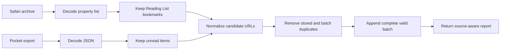

# Template Method Problem: Reading-List Import Pipeline

Problem-definition date: 2026-10-14

Internal Day 071 defines a direct import baseline for a reading app. Safari
archives and Pocket exports use different payloads and source-specific filters,
but accepted articles must pass through the same ordered work: validate the
payload, decode records, normalize URLs, remove duplicates, and persist the
result.

Two explicit import functions keep that order visible. They share small private
helpers for URL policy and deduplication, but there is no base class, template
method, provider protocol, hook hierarchy, or configurable pipeline. With only
two sources and two variable steps, the repetition is still cheaper than an
inheritance boundary.

## Product scenario

A customer is moving saved articles into one reading app. A Safari archive can
contain ordinary bookmarks alongside Reading List items, while a Pocket export
contains unread and archived items. The app imports only the source records that
still belong in an active reading list.

Before persistence, the app trims titles, canonicalizes scheme and host casing,
removes URL fragments and default ports, derives a title from the host when a
source title is blank, and rejects malformed web URLs. Duplicate URLs already
stored or repeated inside one import are skipped in first-seen order.

This teaching unit covers in-memory persistence, one bounded projection of each
provider payload, HTTP and HTTPS articles, deterministic ordering, and an import
report. File picking, security-scoped bookmarks, complete vendor schemas,
network metadata refresh, database transactions, progress UI, cancellation,
and conflict synchronization are outside today's scope.

## Requirements and invariants

| Requirement | Observable behavior |
| --- | --- |
| Payload validation | Empty input fails before provider decoding. |
| Provider decoding | Safari property-list and Pocket JSON failures identify the source. |
| Source selection | Safari keeps Reading List bookmarks; Pocket keeps unread items. |
| URL normalization | Scheme and host casing, fragments, root slashes, and default ports become canonical. |
| Deduplication | Existing and earlier imported URLs keep the first stored entry. |
| Atomic persistence | Any invalid eligible URL rejects the batch without a partial append. |
| Import report | Decoded, eligible, inserted, and duplicate counts remain distinguishable. |

The direct pipeline also preserves these constraints:

1. Only HTTP and HTTPS URLs with a nonempty host can enter the library.
2. Path trailing slashes are preserved because changing them can change the
   resource; only a bare host's root slash is removed.
3. A blank title falls back to the normalized host, so persisted entries always
   have a usable label.
4. Source order is stable after ineligible and duplicate records are removed.
5. A library cannot start with duplicate canonical URLs.
6. Provider decoding and candidate selection vary; normalization,
   deduplication, persistence, and reporting follow the same order.

## Direct Swift first

[`ReadingListImportDirect.swift`](../Sources/DesignPatterns/TemplateMethod/ReadingListImportDirect.swift)
defines `DirectReadingListImporter` with `importSafariArchive(_:into:)` and
`importPocketExport(_:into:)`. Each function spells out the complete pipeline.
Private `Decodable` projections isolate the two payload shapes, while small
helpers own only the policies that are already identical.

`ReadingListLibrary` is a value with a private setter. Both import functions
finish normalization and deduplication before appending, so a thrown error
cannot leave a partially imported batch. `ReadingListImportReport` separates
provider filtering from duplicate removal instead of collapsing every skipped
record into one ambiguous count.

There is no abstract importer, subclass override, protocol with default
implementation, closure table, operation enum, persistence repository, async
task, or provider registry. The example intentionally keeps the repeated order
next to each source's two genuine variations: decoding and record selection.

## Acceptance tests

[`TemplateMethodProblemTests.swift`](../Tests/DesignPatternsTests/TemplateMethodProblemTests.swift)
uses Swift Testing to verify:

- Safari imports only Reading List bookmarks and normalizes their URLs;
- Pocket imports only unread items and supplies a deterministic title fallback;
- duplicate URLs are skipped against both stored and earlier imported entries;
- an invalid URL leaves the complete library unchanged;
- empty input fails before decoding; and
- malformed data reports the provider without changing persistence.

Every test owns a fresh value-semantic library, so the suite remains safe under
Swift Testing's default parallel execution. Run it with:

```sh
swift test -Xswiftc -warnings-as-errors --filter TemplateMethodProblemTests
```

## Initial pipeline flow



Observe the fixed left-to-right order after each source has decoded and selected
its records. An accessible equivalent is: Safari and Pocket enter through
different decoders and filters, converge on the same URL normalization, then
pass through deduplication and one atomic append before the importer reports the
outcome.

## Evidence to gather on Day 072

The common order is real, but two explicit functions are still easy to inspect.
Day 072 will introduce credible provider growth and compare the cost of keeping
that skeleton synchronized with two composition alternatives and inheritance:

- Add a third source or a source rule that makes the duplicated stage order
  materially easier to drift.
- Prove that validation and persistence cannot be skipped or reordered by a
  provider-specific implementation.
- Count repeated orchestration steps separately from legitimately different
  decoding and candidate-selection code.
- Compare a base-class skeleton with a protocol extension, injected closures,
  and one ordinary function taking source operations.
- Keep URL policy, deduplication, storage ownership, and reporting out of
  subclass overrides unless variation is demonstrated.
- Reject Template Method if composition preserves the invariant order with
  less coupling and equally clear call sites.

The goal is not to reward visible duplication automatically. A Template Method
must protect a valuable algorithm invariant more clearly than Swift functions
and values can.

## Initial editorial thesis

**Thesis:** Provider formats may vary, but an import should not be able to skip
the safety rails between raw data and the reading list.

**Scene:** A matte-black archival machine spans the lower frame from left to
right. A layered Safari archive cartridge and a compact Pocket export cassette
enter through two distinct fitted decoder gates, then join one warm-red rail
through normalization, duplicate screening, and a sealed library bay. The rail
has an unmistakable fixed sequence; only the first two source modules differ.
Use no browser logos, UI screens, labels, people, floating dashboards, code, or
decorative circuits.

The final Day 073 header should keep this controlled import-rail metaphor only
if the fixed algorithm earns an explicit skeleton. It must follow
[`visual-style.md`](visual-style.md); no header asset is generated during
problem definition.

## Day 071 decision

The import order and source-specific variation are executable and tested, but
Template Method has not earned inheritance. Two direct functions plus two
shared policy helpers preserve atomic persistence and make every step visible.
The pattern remains a hypothesis until provider growth proves that keeping the
stable skeleton synchronized is a larger risk than coupling implementations to
a base class.
