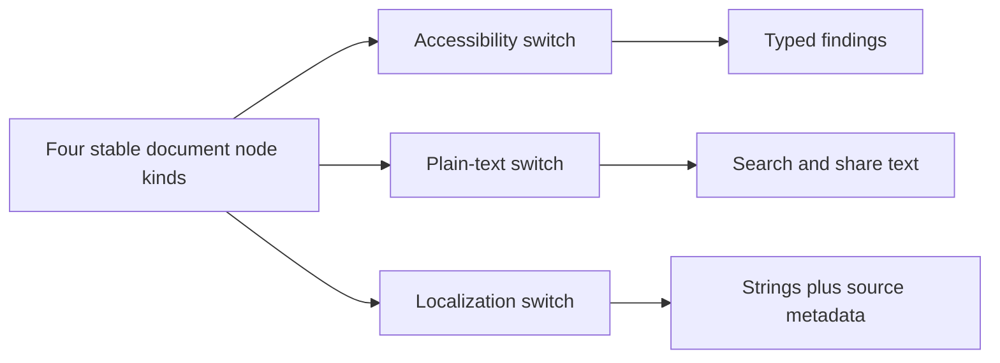

# Visitor Pressure: Operations Multiply Across Stable Document Nodes

Pressure-review date: 2026-10-21

Internal Day 079 adds two credible publishing operations to the accessibility
audit from Day 078. Search and share previews need plain text in source order.
The localization pipeline needs every author-written string together with the
node and asset metadata required to return a translation to the right field.

The paragraph, link, image, and table cases remain unchanged. The direct enum
is still clear, but each operation now owns another exhaustive switch across the
same four cases. That repeated concrete-type dispatch is the pressure Visitor
may remove; the different policies and result types are not duplication.

## New product requirements

The publishing app now performs three independent whole-document operations:

1. Accessibility auditing emits typed findings and carries heading state.
2. Plain-text extraction creates deterministic search and share copy while
   excluding decorative images and empty strings.
3. Localization inventory records translatable source text with stable node,
   table-position, and image-asset metadata.

These operations deliberately disagree where their responsibilities differ. A
decorative image contributes no plain text, while localization still inventories
any authored alternative text that exists. Accessibility reports that text as a
problem. A shared conditional pipeline would conflate those policies.

## Direct implementation under pressure

[`PublishingDocumentPressure.swift`](../Sources/DesignPatterns/Visitor/PublishingDocumentPressure.swift)
keeps the Day 078 model untouched and adds two small operation-owned types:

- `DirectDocumentPlainTextExtractor` walks nodes once and emits normalized
  lines suitable for indexing or a share preview.
- `DirectDocumentLocalizationInventory` walks the same nodes and emits typed
  `PublishingLocalizationEntry` values rather than presentation strings.

Both operations preserve article order. Each switch delegates detailed table
work to a private helper, but the concrete-node decision remains visible. There
is still no visitor protocol, `accept` method, type erasure, operation registry,
generic fold, shared mutable accumulator, or document service.

## Measured extension pressure

| Signal | Day 078 | Day 079 |
| --- | ---: | ---: |
| Whole-document operations | 1 | 3 |
| Ordered node traversals | 1 | 3 |
| Exhaustive node switches | 1 | 3 |
| Concrete case branches | 4 | 12 |
| Node kinds | 4 | 4 |
| Existing model types changed for new operations | 0 | 0 |

The edit direction is now observable:

- A fourth operation adds one operation-owned implementation and four concrete
  behaviors without changing the document model.
- A fifth node kind changes the enum and all three existing operations, because
  each exhaustive switch must learn the new case.

This is the stability profile Visitor expects: operations grow while element
kinds stay fixed. The compiler-enforced enum remains a strong alternative, so
the counts justify evaluating double dispatch on Day 080 rather than deciding
the comparison in advance.

## Acceptance evidence

[`VisitorPressureTests.swift`](../Tests/DesignPatternsTests/VisitorPressureTests.swift)
verifies that:

- plain text preserves document and node order across all four node kinds;
- table captions, headers, and cells flatten deterministically;
- decorative image descriptions do not leak into search or share text;
- localization entries retain node identity, table coordinates, and image
  asset names; and
- absent or whitespace-only authored strings do not create catalogue entries.

The Day 078 accessibility suite continues to prove the first operation. Run all
direct Visitor stages with warnings treated as errors:

```sh
swift test -Xswiftc -warnings-as-errors --filter Visitor
```

## Pressure flow



Observe the repeated type decision, not the distinct outputs. One stable set of
document nodes fans out to three operation-owned traversals; each traversal
switches across the same four cases before producing its own result. An
accessible equivalent is: four fixed node kinds feed accessibility, text, and
localization operations; every operation repeats concrete-node dispatch, then
returns findings, preview text, or catalogue entries respectively.

## Alternatives before Visitor

| Alternative | Strength | Limit under today's pressure |
| --- | --- | --- |
| Keep exhaustive enum switches | Minimal types, local reasoning, compiler checks every node case. | Every new operation repeats traversal and four-way dispatch. |
| Add behavior to each node value | Keeps behavior beside data when one behavior is intrinsic. | Three unrelated output concerns would spread through every data type. |
| Use one generic fold with four closures | Shares traversal while preserving enum exhaustiveness. | Every call site still supplies a four-closure matrix, and cross-node state or different result shapes complicate the fold. |
| Use free functions per node case | Reuses small transformations. | Helpers remove rule duplication, not the repeated concrete-type decision. |
| Introduce Visitor | Centralizes dispatch in stable elements and groups each operation in one visitor. | Adds protocols, `accept`, dynamic dispatch, and a high cost when node kinds change. |

The enum is preferable if this operation set stops growing. Protocol
requirements are preferable if a behavior is an invariant capability of every
node rather than an external publishing concern. A generic fold is worthwhile
only if it makes call sites smaller than the switches it replaces.

## Boundary carried into Day 080

Visitor may replace the direct pressure implementation only if it:

- keeps paragraph, link, image, and table as the complete stable element set;
- uses one `accept` dispatch point per element and one operation protocol;
- keeps accessibility, extraction, and localization policies in separate
  operation types with their existing observable behavior;
- preserves article order and any operation-owned traversal state;
- makes a fourth operation possible without editing existing elements;
- documents that a new node kind must update the operation protocol and every
  visitor; and
- avoids a node superclass, generic result algebra, type erasure, registry,
  dependency container, async layer, or mutable shared context.

## Day 079 decision

Visitor has earned a focused comparison: three real operations now repeat three
ordered traversals, three exhaustive switches, and twelve concrete branches
over four unchanged node kinds. It has not earned control over the operations'
policies or results. Day 080 must show that one minimal double-dispatch boundary
removes repeated type selection without making the closed enum alternative look
artificially worse.
