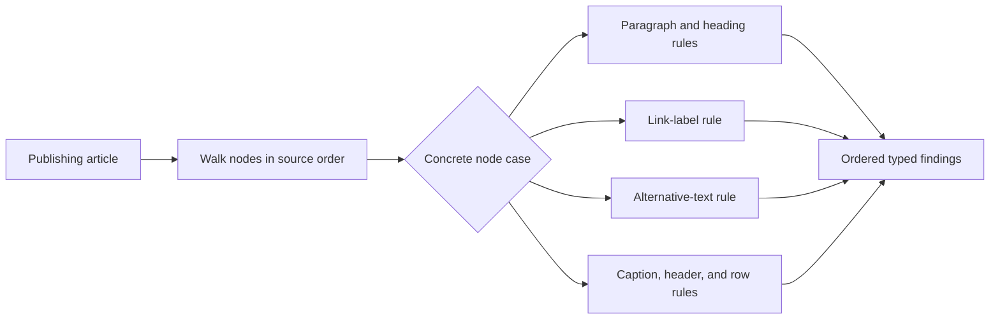

# Visitor Problem: Publishing Document Operations

Problem-definition date: 2026-10-20

Internal Day 078 defines a direct accessibility-audit baseline for a publishing
app. Its article model has a deliberately stable set of paragraph, link, image,
and table nodes. Before publication, an editor needs one whole-document audit
whose rules depend on the concrete node type and sometimes on document order.

An enum plus one exhaustive switch keeps that operation explicit. The compiler
shows every supported node, the traversal stays local, and no node protocol,
visitor protocol, `accept` method, double dispatch, type erasure, or operation
object is needed. Visitor remains a hypothesis until more independent document
operations make repeated concrete-type dispatch a demonstrated maintenance cost.

## Product scenario

A city-guide publisher prepares articles that must remain useful with VoiceOver
and other assistive technologies. Body paragraphs cannot be empty, headings
must not skip levels, link labels must make sense outside their surrounding
sentence, informative images need alternative text, decorative images must stay
silent, and data tables need captions, headers, and consistent row shapes.

The audit walks the article in source order so findings can take an editor to
the correct location and heading checks can see the preceding heading. It
returns typed findings instead of presentation copy; localization and UI decide
how those findings are explained to an author.

This teaching unit covers an in-memory article, four stable node cases, one
synchronous accessibility audit, deterministic finding order, and a focused set
of publishing rules. Rich text spans, nested lists, embedded media, remote asset
inspection, WCAG conformance claims, automatic repair, persistence, editor UI,
localization, and concurrent document mutation are outside today's scope.

## Requirements and invariants

| Requirement | Observable behavior |
| --- | --- |
| Stable traversal | Nodes are audited once in article order and findings keep that order. |
| Paragraph semantics | Blank copy is reported and headings cannot jump over a level. |
| Link context | Blank or generic labels such as `Read more` are reported. |
| Image semantics | Informative images require alternative text; decorative images must remain silent. |
| Table semantics | Tables require a caption, usable headers, and rows matching the header count. |
| Typed result | The report contains domain findings rather than localized UI strings. |

The direct document model also preserves these constraints:

1. Every node has a nonempty stable identifier so a finding can target it.
2. Heading levels stay within HTML's 1...6 range.
3. Link destinations and image asset names are required domain data, even
   though this audit does not fetch or validate them.
4. A table may temporarily contain malformed authoring data because reporting
   that state is the operation's job; construction does not hide the defect.
5. The audit reads value-semantic nodes and never mutates the article.
6. The first heading is compared with level zero, so starting at level two or
   deeper is observable as a skipped level.

## Direct Swift first

[`PublishingDocumentDirect.swift`](../Sources/DesignPatterns/Visitor/PublishingDocumentDirect.swift)
models `PublishingDocumentNode` as an enum with paragraph, link, image, and table
cases. Each case carries a focused value type, while `PublishingDocument` keeps
the ordered article structure.

`DirectDocumentAccessibilityAuditor.audit(_:)` loops over the nodes once and
uses one exhaustive switch. Small private functions hold the concrete rules so
the traversal remains readable. Only heading progression needs cross-node state;
all other findings come directly from one node. `DocumentAccessibilityReport`
preserves typed findings in detection order and derives its pass result from an
empty finding list.

There is no document-node protocol, accessibility requirement on every node,
visitor, `accept` method, dynamic cast, closure registry, generic fold, tree
walker, repository, or async pipeline. With one operation and four closed cases,
the enum is both the smallest design and the strongest exhaustiveness check.

## Acceptance tests

[`VisitorProblemTests.swift`](../Tests/DesignPatternsTests/VisitorProblemTests.swift)
uses Swift Testing to verify:

- an article satisfying every concrete node rule passes without findings;
- paragraph, link, image, and table failures are emitted in source order;
- heading progression is checked across intervening body paragraphs;
- every table row with a mismatched shape identifies its source index; and
- decorative images are silent only when they omit alternative text.

Every test constructs immutable local documents and shares only the stateless
auditor and one immutable valid fixture, so the suite remains safe under Swift
Testing's default parallel execution. Run it with:

```sh
swift test -Xswiftc -warnings-as-errors --filter VisitorProblemTests
```

## Initial audit flow



Observe the single concrete-type decision in the middle: one accessibility
operation owns traversal and branches explicitly for all four stable node cases.
An accessible equivalent is: the article enters one ordered walk; each node is
sent to paragraph, link, image, or table accessibility rules; every rule appends
typed findings to one source-ordered report.

## Evidence to gather on Day 079

One exhaustive operation is easier to review than a double-dispatch protocol
family. Day 079 must add credible whole-document work before Visitor can earn
its participants:

- Add plain-text extraction for search and share previews.
- Add localization inventory for author-written strings and asset metadata.
- Count repeated node switches, traversal loops, and case-specific branches
  across the three operations.
- Show whether adding an operation edits operation-owned code only or forces
  behavior into every document-node type.
- Verify that node kinds remain unchanged while operations grow.
- Compare Visitor with enum switches, protocol requirements, a generic fold,
  and small free functions before accepting double dispatch.
- Reject Visitor if the enum remains clearer or if node kinds start changing as
  often as operations.

The evidence must distinguish operation growth from ordinary helper reuse.
Moving four small switch branches behind visitor types is not automatically a
reduction in complexity.

## Initial editorial thesis

**Thesis:** When a document's building blocks stay fixed, every new publishing
operation should move through them without rewriting the structure.

**Scene:** A matte-black editorial inspection line fills the middle and lower
frame from left to right. Four fixed modules—a text galley, linked reference
coupling, image plate, and tabular grid cartridge—sit in one stable rail. A
single warm-red accessibility scanner travels across each module and deposits
precise issue markers into an ordered tray at the far right. The document
modules do not move or change shape. Use no screen UI, labels, people, browser
icons, floating dashboards, code, checkmarks, or decorative circuits.

The final Day 080 header should retain this moving-operation-over-stable-nodes
metaphor only if Day 079 proves that operations grow more often than node kinds.
It must follow [`visual-style.md`](visual-style.md); no header asset is generated
during problem definition.

## Day 078 decision

The stable node set and node-specific accessibility rules are executable, but
Visitor has not earned double dispatch. One enum and one exhaustive switch keep
the concrete cases visible, preserve ordering, and avoid distributing one audit
across the document model. The pattern remains a hypothesis until additional
operations demonstrate repeated dispatch without corresponding node growth.
