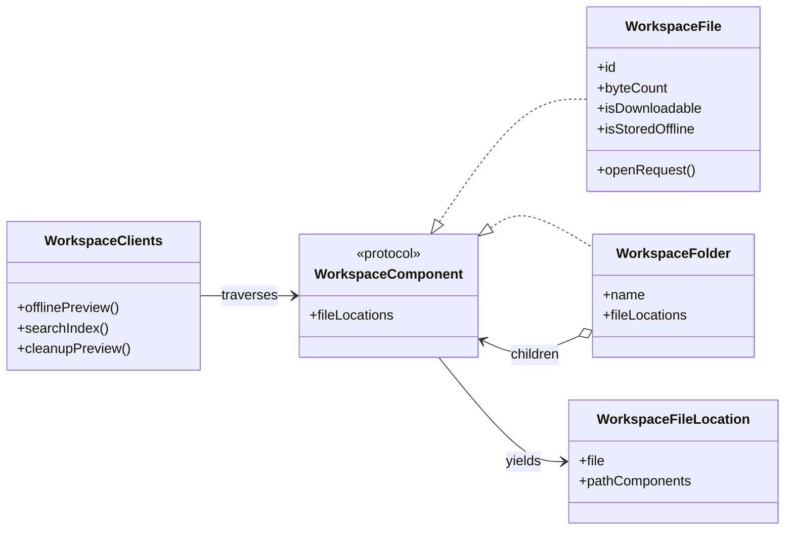

# 🗂️ Composite


> **Caption:** One traversal rail carries a leaf file and nested folders toward
> the same offline boundary while every concrete document remains visible.

**Category:** Structural

## 🎯 The app problem

A field-service app lets engineers select workspace content before travelling
to sites with unreliable connectivity. The workspace contains files and folders,
and a folder may contain both files and other folders.

Three clients need the same hierarchy:

- offline selection counts files, totals bytes, and rejects a selection with a
  restricted file;
- search indexing emits one record per file with its complete folder path; and
- storage cleanup totals files already stored on the device, regardless of
  whether they remain downloadable.

### Requirements

- Accept either one file or an arbitrarily nested folder at each client boundary.
- Visit every descendant file exactly once in workspace order.
- Preserve complete folder paths for search records.
- Keep download permission separate from local-storage cleanup policy.
- Treat an empty folder as an unavailable offline selection.
- Keep opening a file as a leaf-only operation rather than pretending folders
  can open like documents.

## 🪶 Start with direct Swift

[`WorkspaceOfflineDirect.swift`](../../Sources/DesignPatterns/Composite/WorkspaceOfflineDirect.swift)
uses a closed `DirectWorkspaceEntry` indirect enum with file and folder cases.
`DirectOfflineSelectionPreview` switches once and recursively reduces child
summaries. With one client, this is the clearest design: the compiler checks the
complete hierarchy and no protocol or existential is needed.

The direct version is not a failed architecture. It is the preferred option
while the tree is closed and one or two short recursive functions remain easy
to audit.

## ⚡ The turning point

[`WorkspaceOfflinePressure.swift`](../../Sources/DesignPatterns/Composite/WorkspaceOfflinePressure.swift)
adds search indexing and storage cleanup. The direct design now contains:

- three recursive client operations;
- three file-or-folder switches;
- three child traversal loops; and
- three distinct leaf policies that must not be merged.

Moving every rule into one enum method would replace repeated branching with a
multi-purpose helper full of flags, callbacks, or optional accumulators. The
pressure is not that recursion is difficult; it is that structural traversal
has three owners.

## 🧭 Pattern intent

Composite lets a client treat one leaf and a nested container through the same
component boundary. A `WorkspaceFile` yields one located file. A
`WorkspaceFolder` asks each child for its locations, prefixes its own name, and
combines the results. Clients consume those locations without branching on the
shape of the tree.

The common operation owns only traversal. It does not decide whether a file may
be downloaded, whether it belongs in search, how cleanup works, or how a file
opens.

## 🧩 Participants and responsibilities

| App role | Swift type | Responsibility |
| --- | --- | --- |
| Component boundary | [`WorkspaceComponent`](../../Sources/DesignPatterns/Composite/WorkspaceComposite.swift) | Exposes one uniform `fileLocations` traversal result. |
| Leaf | [`WorkspaceFile`](../../Sources/DesignPatterns/Composite/WorkspaceOfflineDirect.swift) | Returns itself with its filename as the initial path and retains file-only state and operations. |
| Composite | [`WorkspaceFolder`](../../Sources/DesignPatterns/Composite/WorkspaceComposite.swift) | Holds heterogeneous child components, delegates traversal, and prefixes its folder name. |
| Traversal value | [`WorkspaceFileLocation`](../../Sources/DesignPatterns/Composite/WorkspaceComposite.swift) | Keeps a concrete file beside its ordered path components. |
| Clients | [`WorkspaceOfflineSelectionPreview`](../../Sources/DesignPatterns/Composite/WorkspaceComposite.swift), [`WorkspaceSearchIndexer`](../../Sources/DesignPatterns/Composite/WorkspaceComposite.swift), and [`WorkspaceCleanupPreview`](../../Sources/DesignPatterns/Composite/WorkspaceComposite.swift) | Map, filter, or reduce located files according to separate product policies. |
| Leaf-only request | [`WorkspaceFileOpenRequest`](../../Sources/DesignPatterns/Composite/WorkspaceComposite.swift) | Represents opening one concrete file and deliberately does not belong to the component protocol. |

The protocol has two immediate participants and one demonstrated operation.
That operation varies structurally between a leaf and a container, so this is
not a protocol created for a single implementation.

## ⚙️ How the Swift implementation works

1. `WorkspaceFile.fileLocations` returns one location containing itself and its
   filename.
2. `WorkspaceFolder.fileLocations` asks every child component for its locations.
3. The folder prefixes its name to every child path and flattens the results in
   child order.
4. Nested folders repeat the same delegation without exposing their shape to
   clients.
5. Offline preview, search, and cleanup receive `any WorkspaceComponent` and
   operate only on the returned locations.
6. `WorkspaceFile.openRequest()` stays on the concrete leaf, so a folder is not
   forced to implement a meaningless open operation.

The composition root remains explicit:

```swift
let briefing = WorkspaceFolder(
    name: "Briefing",
    children: [inspectionPlan, safetyVideo]
)

let visit = WorkspaceFolder(
    name: "Site visit",
    children: [briefing, checklist]
)

let summary = WorkspaceOfflineSelectionPreview().summary(for: visit)
let records = WorkspaceSearchIndexer().records(in: visit)
```

No client asks whether `visit` is a file or folder. The folder owns recursion;
the clients still own what each file means to their feature.

## 🗺️ Diagram



Observe that both the file and folder satisfy one narrow component boundary.
Only the folder contains more components, and every client points to the common
boundary rather than to the two concrete shapes. `openRequest()` appears only
on `WorkspaceFile`, outside the shared traversal contract.

**Accessible description:** A workspace component can be either a file or a
folder. A folder contains more workspace components, so nesting can continue to
any depth. Both file and folder yield file locations to the offline, search, and
cleanup clients. Only a concrete file can create an open request.

## ▶️ Run the example

From the repository root:

```sh
swift test -Xswiftc -warnings-as-errors --filter CompositeTests
```

The example uses deterministic in-memory values. It requires no filesystem,
network connection, database, or Apple document framework.

## 🧪 Tests

```sh
swift test -Xswiftc -warnings-as-errors --filter CompositeTests
swift test -Xswiftc -warnings-as-errors --filter CompositeProblemTests
swift test -Xswiftc -warnings-as-errors --filter CompositePressureTests
```

[`CompositeTests.swift`](../../Tests/DesignPatternsTests/CompositeTests.swift)
proves:

- one file and one nested folder substitute through the same component boundary;
- nested files preserve depth-first order and complete display paths;
- one shared subtree derives independent paths under two parents without storing
  parent state;
- restricted leaves propagate through offline-selection policy;
- cleanup includes stored restricted data but ignores unstored files;
- an empty folder yields no locations and remains unavailable offline; and
- an open request is created from the concrete file rather than the component
  protocol.

The problem and pressure suites retain the direct enum baseline and the three
client-owned recursive walks that earned the pattern.

## ⚖️ Trade-offs

### What improves

- Three clients no longer switch between file and folder or recurse through
  child entries.
- Folder path construction has one owner and preserves child order once.
- A new container shape can implement `WorkspaceComponent` without editing
  every client switch.
- Offline, search, and cleanup rules remain small and independently testable.
- File-only behavior stays visible on `WorkspaceFile`.

### What it costs

- The final design adds one protocol, one traversal value, one composite type,
  and an existential child array.
- `fileLocations` allocates arrays while flattening each level. A very large or
  remotely paginated tree may need lazy iteration instead.
- The protocol opens a hierarchy that the original enum closed exhaustively.
  New conformers must preserve path and ordering invariants.
- This value-oriented example trusts app-owned acyclic composition. Importing
  arbitrary graph data would require cycle validation and identity rules.

## 🔀 Alternatives considered

| Alternative | Prefer it when | Why it does not meet this example now |
| --- | --- | --- |
| Indirect enum with recursive functions | The hierarchy is closed and only one or two operations traverse it. | Three clients already repeat the same branch and walk. |
| One free traversal function | All clients live in one module and extension by new component types is not required. | It can remove recursion duplication, but still switches on the closed enum and couples every new shape to that function. |
| Generic recursive reducer | Many consumers truly need one configurable fold and can understand its accumulator contract. | It moves complexity into closures and accumulator plumbing before that abstraction has a clear product name. |
| Iterator or `Sequence` | Traversal must be lazy, cancellable, streaming, or able to stop early. | The current in-memory workspace is small and every demonstrated client consumes all files. |
| Visitor | Many stable node types need frequently added operations with double dispatch. | There are only two node shapes, and visitor machinery would expose more hierarchy detail than clients need. |
| Decorator | Wrappers add optional behavior around one component operation. | Folders contain peer components; they do not wrap one child to add behavior. |
| Flyweight | Many repeated leaves need shared intrinsic state to reduce memory. | The problem is recursive composition and client branching, not duplicated file metadata. |

Composite and Decorator can both nest values behind one interface. Composite
forms a part-whole tree where containers aggregate peer components. Decorator
forms a wrapper chain where each layer adds behavior around one wrapped value.

## 🚫 When not to use it

- Keep the indirect enum when file and folder are the complete, stable set and
  recursive clients remain few.
- Prefer a direct recursive function when traversal is module-private and no
  client needs to substitute a leaf and container through one boundary.
- Do not add parent links, mutation APIs, repositories, or cycle detection to a
  read-only value tree without requirements for them.
- Do not put file-only operations on `WorkspaceComponent`; a folder should not
  fake opening, decoding, or downloading one file.
- Do not eagerly flatten a hierarchy that is too large for memory or backed by
  pagination; use a lazy `Sequence` or `AsyncSequence` instead.
- Do not use Composite merely because one type owns an array. The children must
  share the same meaningful operation as the container.

## 🗂️ Source map

- [`WorkspaceComposite.swift`](../../Sources/DesignPatterns/Composite/WorkspaceComposite.swift) — component boundary, leaf conformance, folder composite, traversal value, final clients, and leaf-only open request.
- [`WorkspaceOfflineDirect.swift`](../../Sources/DesignPatterns/Composite/WorkspaceOfflineDirect.swift) — workspace values, direct recursive enum, and original offline preview.
- [`WorkspaceOfflinePressure.swift`](../../Sources/DesignPatterns/Composite/WorkspaceOfflinePressure.swift) — duplicated search and cleanup recursion.
- [`CompositeTests.swift`](../../Tests/DesignPatternsTests/CompositeTests.swift) — final uniform traversal and policy tests.
- [`CompositeProblemTests.swift`](../../Tests/DesignPatternsTests/CompositeProblemTests.swift) — direct baseline acceptance tests.
- [`CompositePressureTests.swift`](../../Tests/DesignPatternsTests/CompositePressureTests.swift) — repeated-client pressure evidence.
- [`composite-problem.md`](../../Documentation/composite-problem.md) — requirements, invariants, and direct-design decision.
- [`composite-pressure.md`](../../Documentation/composite-pressure.md) — measured duplication and pattern boundary.
- [`composite-header.png`](../../Documentation/Assets/Patterns/structural/composite-header.png) — editorial header.
