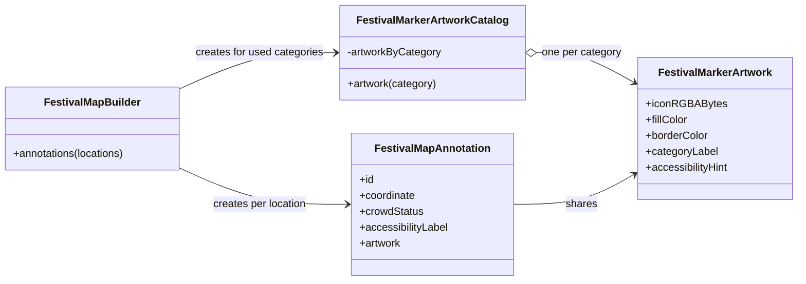

# 🪶 Flyweight


> **Caption:** Four immutable marker resources serve thousands of unique map
> locations without copying the decoded artwork into every annotation.

**Category:** Structural

## 🎯 The app problem

A festival companion app renders stages, food courts, restrooms, and first-aid
points across a large multi-day site. Every map location owns an identifier,
name, coordinate, and live crowd status, but locations in the same category use
the same marker pixels, colors, category label, and accessibility hint.

The rendering boundary expects a decoded 32 × 32 RGBA buffer. A representative
feed contains 20,000 locations across four categories, so rebuilding complete
artwork per annotation retains 81,920,000 pixel bytes even though only four
distinct images exist.

### Requirements

- Preserve feed order and every location's unique map and crowd state.
- Keep the accessible label specific to the location and its current status.
- Produce deterministic pixels, colors, labels, and hints for each category.
- Create no more than one immutable artwork resource per category used in a
  build.
- Let annotations in one category share identity while different categories
  remain distinct.
- Avoid global caches, eviction policy, synchronization, and renderer-specific
  infrastructure.

Map clustering, viewport queries, image files, localization, networking,
spatial indexes, annotation-view reuse, and UI framework caches remain outside
this example. Those concerns can change the best production solution, but they
do not change the ownership boundary demonstrated here.

## 🪶 Start with direct Swift

[`FestivalMapDirect.swift`](../../Sources/DesignPatterns/Flyweight/FestivalMapDirect.swift)
uses `DirectFestivalMapBuilder` to map every location once. An exhaustive enum
switch selects its category descriptor, a fresh 4,096-byte buffer is decoded,
and one `DirectFestivalMarkerArtwork` is attached to the annotation.

That is the better design for a small or short-lived map. Ownership is obvious,
there is no lookup table, and the caller receives complete annotation values.
Visible repetition alone does not justify Flyweight, especially when an asset
catalogue or map SDK may already share decoded resources.

## ⚡ The turning point

[`FestivalMapPressure.swift`](../../Sources/DesignPatterns/Flyweight/FestivalMapPressure.swift)
profiles the direct result without estimating process RSS. The 20,000-location
fixture records:

| Evidence | Direct result | One resource per category | Reduction |
| --- | ---: | ---: | ---: |
| Artwork objects | 20,000 | 4 | 19,996 |
| Decoded-icon constructions | 20,000 | 4 | 19,996 |
| Pixel payload | 81,920,000 bytes | 16,384 bytes | 81,903,616 bytes |
| Pixel payload in MiB | 78.125 MiB | 0.015625 MiB | 78.109375 MiB |

The shareable representation removes 99.98% of the decoded pixel payload in
this workload. The count excludes object headers, array capacity, allocator
rounding, strings, renderer copies, and framework caches, so it is not presented
as a process-memory measurement. It is the exact payload owned by this model.

## 🧭 Pattern intent

Flyweight separates state that many objects can share from state that remains
specific to each use. `FestivalMarkerArtwork` contains the immutable intrinsic
category resource. `FestivalMapAnnotation` keeps the extrinsic identifier,
title, coordinate, crowd status, and accessible summary.

`FestivalMarkerArtworkCatalog` creates one artwork object for every category
present in the current feed. The builder performs one category lookup per
location and attaches the returned reference without copying its pixels.

The catalog is scoped to one build rather than stored globally. Returned
annotations retain their shared artwork, and releasing the annotation result
also permits those resources to be released. This is deliberate Flyweight
sharing without turning the catalogue into a Singleton or general cache.

## 🧩 Participants and responsibilities

| App role | Swift type | Responsibility |
| --- | --- | --- |
| Extrinsic source | [`FestivalMapLocation`](../../Sources/DesignPatterns/Flyweight/FestivalMapDirect.swift) | Supplies the unique identifier, name, coordinate, category, and crowd status. |
| Flyweight | [`FestivalMarkerArtwork`](../../Sources/DesignPatterns/Flyweight/FestivalMapFlyweight.swift) | Holds immutable decoded pixels, colors, category label, and accessibility hint shared by one category. |
| Flyweight catalogue | [`FestivalMarkerArtworkCatalog`](../../Sources/DesignPatterns/Flyweight/FestivalMapFlyweight.swift) | Builds one artwork object for each used category and returns it through a category-keyed lookup. |
| Context | [`FestivalMapAnnotation`](../../Sources/DesignPatterns/Flyweight/FestivalMapFlyweight.swift) | Combines one shared artwork reference with per-location map and accessibility state. |
| Client | [`FestivalMapBuilder`](../../Sources/DesignPatterns/Flyweight/FestivalMapFlyweight.swift) | Discovers used categories, creates the request-scoped catalogue, and assembles annotations in feed order. |

There is no protocol because neither artwork creation nor lookup has a second
implementation or an external boundary. The closed category enum and one small
dictionary express the immediate variation completely.

## ⚙️ How the Swift implementation works

1. `FestivalMapBuilder` derives a `Set` of categories used by the input feed.
2. `FestivalMarkerArtworkCatalog` walks the exhaustive `allCases` list and
   decodes exactly one immutable resource for each used category.
3. The builder walks the original locations in their original order.
4. Each location performs one dictionary lookup by `FestivalVenueCategory`.
5. The builder combines the shared artwork with the location's identifier,
   title, coordinate, status, and accessible summary.
6. Annotations in the same category retain the same artwork identity; category
   changes select a different identity.
7. The temporary catalogue goes out of scope, while the returned annotations
   keep only the resources they actually use alive.

The composition remains small:

```swift
let locations = [northStage, sunsetStage, marketFoodCourt]
let annotations = FestivalMapBuilder().annotations(for: locations)

annotations[0].artwork === annotations[1].artwork // true: both stages
annotations[0].artwork === annotations[2].artwork // false: stage vs food
```

For `n` locations and `k` used categories, construction is `O(n + k)`, lookup
is expected `O(1)` per annotation, and intrinsic resource storage is `O(k)`.
Here `k` is bounded by the four-case enum. The 20,000-location fixture therefore
trades 20,000 small dictionary reads for 19,996 fewer decodes and artwork
objects.

## 🗺️ Diagram



Observe the two different multiplicities: the builder creates one annotation
per location but the catalogue creates one artwork object per category. Every
annotation points to a category resource rather than owning another decoded
buffer.

**Accessible description:** The festival-map builder creates a temporary
artwork catalogue and one annotation for every location. The catalogue owns one
immutable artwork object for each used venue category. Many annotations share
one of those artwork objects while keeping their own identifiers, coordinates,
crowd statuses, and accessibility labels.

## ▶️ Run the example

From the repository root:

```sh
swift test -Xswiftc -warnings-as-errors --filter FlyweightTests
```

The example is synchronous and deterministic. It needs no map framework, asset
catalogue, filesystem, network connection, database, or global cache.

## 🧪 Tests

```sh
swift test -Xswiftc -warnings-as-errors --filter FlyweightTests
swift test -Xswiftc -warnings-as-errors --filter FlyweightProblemTests
swift test -Xswiftc -warnings-as-errors --filter FlyweightPressureTests
```

[`FlyweightTests.swift`](../../Tests/DesignPatternsTests/FlyweightTests.swift)
proves:

- two stages retain the same artwork identity;
- a stage and food court retain different identities and pixels;
- identifiers, coordinates, crowd status, order, and accessible labels remain
  specific to each location;
- an empty feed creates no output or shared resources; and
- the representative workload falls from 20,000 artwork objects and 81,920,000
  pixel bytes to 4 objects and 16,384 bytes.

The problem and pressure suites retain the complete direct baseline and its
quantitative evidence. They are not alternate production architectures.

## ⚖️ Trade-offs

### What improves

- Decoded pixel payload falls by 81,903,616 bytes in the representative feed.
- Only four artwork objects and icon decodes replace 20,000 equivalents.
- Intrinsic and extrinsic state have explicit, reviewable ownership.
- Immutable reference sharing is safe across concurrent readers.
- The catalogue lifetime is bounded by one build and the annotations returned
  from it; tests do not need to reset global state.

### What it costs

- Every annotation performs one dictionary lookup instead of constructing its
  artwork directly.
- The builder first walks the feed to collect its used categories, then walks it
  again to create annotations.
- A new build decodes its used category resources again; this implementation
  deliberately does not cache across map snapshots.
- Reference identity now matters for resource sharing, while annotation state
  remains value-oriented.
- Adding a category requires updating the exhaustive descriptor switch, which
  is desirable while the category set remains closed.

## 🔀 Alternatives considered

| Alternative | Prefer it when | Why it does not meet this example now |
| --- | --- | --- |
| Direct per-annotation artwork | The live map is small or artwork is cheap and short-lived. | The verified workload retains 78.109375 MiB of repeated pixel payload. |
| Named assets resolved by the UI framework | The renderer documents decoded-resource sharing and accepts stable asset identifiers. | That is a simpler production option, but this example's boundary explicitly receives decoded RGBA buffers. |
| Global image cache | Resources must survive many independent map snapshots and real profiling justifies the retention. | It adds synchronization, invalidation, memory limits, and test-reset rules absent from the current requirement. |
| Static property per category | The four resources should live for the entire process. | Process-wide lifetime would retain unused artwork and hide ownership for a benefit not measured here. |
| Compressed data per annotation | Transport or disk size matters more than render-ready memory. | It repeats payload ownership and may shift decoding work into the rendering path. |

Flyweight is not a synonym for any cache. This catalogue has a complete bounded
key set, no misses after construction, no eviction, and no cross-build lifetime.
A cache answers repeated access over time; this Flyweight answers how many live
objects may share one immutable representation.

Flyweight also differs from Prototype. Prototype creates another object with an
intentional copy policy, often to preserve independent mutable state. Flyweight
does the opposite for intrinsic state: many contexts deliberately retain the
same immutable object.

It is not a Singleton either. The catalogue is created inside one build and is
discarded immediately afterwards. Making it globally unique would add hidden
lifetime and test coupling without improving the four-resource result.

## 🚫 When not to use it

- Keep the direct builder when only dozens of markers are visible and memory
  profiling shows no material repetition.
- Let the platform own sharing when `UIImage`, `NSImage`, an asset catalogue, or
  the map SDK already deduplicates decoded marker resources.
- Do not share mutable artwork. Per-location tint, selection state, animation,
  or badges belong on the annotation or another explicit context value.
- Avoid a flyweight table when almost every object has unique intrinsic data;
  the lookup then adds work without reducing storage.
- Do not use an unbounded external identifier as the key without retention,
  invalidation, and eviction requirements.
- Do not introduce a protocol, generic cache, actor, weak table, repository, or
  dependency-injection layer merely to rename this four-entry catalogue.
- Prefer a direct enum switch when the framework accepts lightweight category
  identifiers and performs resource resolution itself.

## 🗂️ Source map

- [`FestivalMapFlyweight.swift`](../../Sources/DesignPatterns/Flyweight/FestivalMapFlyweight.swift) — shared artwork, request-scoped catalogue, annotation context, and final builder.
- [`FestivalMapDirect.swift`](../../Sources/DesignPatterns/Flyweight/FestivalMapDirect.swift) — domain values, category descriptors, decoded-pixel fixture, and direct baseline.
- [`FestivalMapPressure.swift`](../../Sources/DesignPatterns/Flyweight/FestivalMapPressure.swift) — direct ownership and pixel-payload profile.
- [`FlyweightTests.swift`](../../Tests/DesignPatternsTests/FlyweightTests.swift) — sharing, preserved context, empty input, and before/after evidence.
- [`FlyweightProblemTests.swift`](../../Tests/DesignPatternsTests/FlyweightProblemTests.swift) — direct baseline acceptance tests.
- [`FlyweightPressureTests.swift`](../../Tests/DesignPatternsTests/FlyweightPressureTests.swift) — representative direct-memory evidence.
- [`flyweight-problem.md`](../../Documentation/flyweight-problem.md) — app scope, invariants, and direct-design decision.
- [`flyweight-pressure.md`](../../Documentation/flyweight-pressure.md) — quantitative turning point and alternatives evaluated before sharing.
- [`flyweight-header.png`](../../Documentation/Assets/Patterns/structural/flyweight-header.png) — editorial header.

## 📚 Further reading

- *Design Patterns* — Gamma, Helm, Johnson, Vlissides.
- Swift documentation for [`Dictionary`](https://developer.apple.com/documentation/swift/dictionary), used as the bounded category lookup.
- Apple documentation for [`ObjectIdentifier`](https://developer.apple.com/documentation/swift/objectidentifier), used only in tests to verify shared reference identity.
